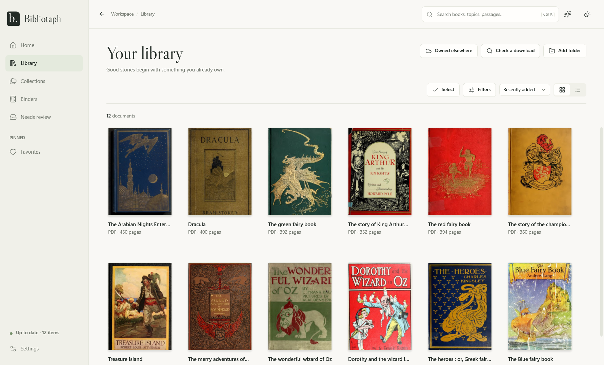
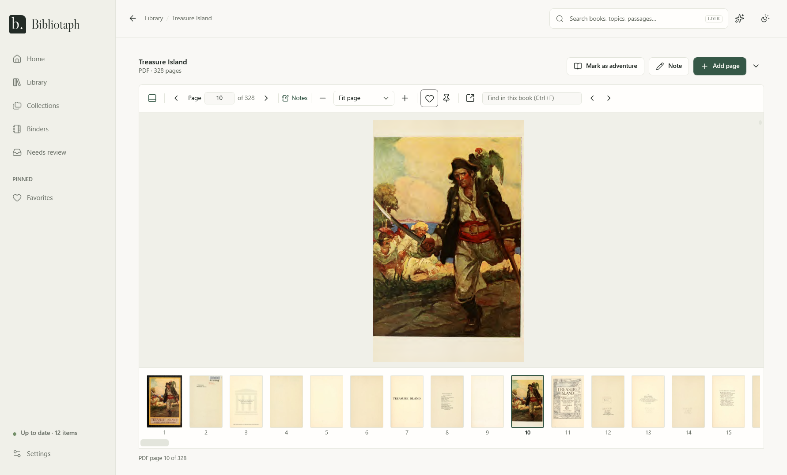

# Bibliotaph

**Find the right book, and the right page, in the RPG library you already have.**

Bibliotaph is a free Windows app for game masters. Point it at the folders where your PDFs, maps and handouts live, and
it builds a catalog of them, right where they are. Then you can search every page of every book, filter by game system,
type and level, and open a book at the page you need.

It's for you if you have a few hundred (or a few thousand) bundle downloads, crowdfunding rewards and scanned
handouts spread over folders, and you keep thinking "I own something for this, but where?"

- **Your files stay put.** Bibliotaph never moves, renames, edits or deletes them. It only reads them.
- **It works offline.** Everything lives on your PC. There's no account, no subscription and no cloud service.
- **AI is optional, and local.** If you want, an AI model running on your own PC fills in each book's system, type and
  levels, quoting the page it found them on. Bibliotaph can download and run one itself (Qwen3, Llama 3.1, Mistral and
  others, or a model file you already have), or use Ollama, LM Studio or another model server you already have. Without it, everything else still works.

This is version 1.4. Everything below is in it, and [CHANGELOG.md](CHANGELOG.md) says what changed in each version.

  

  

The books in these pictures are public-domain scans from the
<a href="https://archive.org">Internet Archive</a>.

## Install

You need Windows 10 (version 1809 or later) or Windows 11, on a 64-bit PC.

1. Open the [latest release](https://github.com/munkycdev/bibliotaph/releases/latest) page.
2. Under **Assets**, click **BibliotaphApp-win-Setup.exe** to download it.
3. Run it. It installs for your Windows account only, so it doesn't ask for an administrator password, and opens
   Bibliotaph when it's done.

Bibliotaph isn't code-signed yet, so Windows may say "Windows protected your PC". Click **More info**, then
**Run anyway**. After that, open Bibliotaph from the Start menu like any other app.

Updates download by themselves. When one is ready, the sidebar says **Update ready: restart to update**; click it
when it suits you. Nothing restarts in the middle of a game.

More in [Getting started](docs/guide/getting-started.md).

## Code signing policy

Free code signing provided by [SignPath.io](https://about.signpath.io/), certificate by
[SignPath Foundation](https://signpath.org/).

Signing isn't set up yet; this is how it will work. Releases are built only by the Release workflow
([.github/workflows/release.yml](.github/workflows/release.yml)), on GitHub-hosted runners, from a version tag in this
repository. The workflow sends the installer it built, `BibliotaphApp-win-Setup.exe`, to SignPath, and a maintainer
approves each signing request by hand. The programs the
installer carries from other projects (the .NET runtime, PDFium, llama.cpp's `llama-server` and Velopack's updater)
keep their own publishers' signatures, or none, and aren't signed as Bibliotaph's.

Team roles:

- Committers and reviewers: [munkycdev](https://github.com/munkycdev)
- Approvers: [munkycdev](https://github.com/munkycdev)

### Privacy

Bibliotaph collects nothing about you or your library and sends nothing to its maintainers. It indexes your files on
your PC, and the built-in AI runs there too. It connects to the internet only for these:

- **Updates.** An installed copy checks this repository's GitHub Releases when it starts and once a day, and downloads
  a newer version if there is one.
- **AI models.** Settings > AI downloads a model from Hugging Face only when you choose one.
- **Book catalogues.** Bibliotaph sends the ISBNs a book prints, and nothing else, to [Open Library](https://openlibrary.org)
  to suggest its title, authors, publisher and year; see [Cataloging](docs/guide/cataloging.md#where-suggestions-come-from).
  A PC connected to your web library asks through bibliotaph.online instead, with the book's title, which asks RPGGeek
  and Google Books too.
- **Online libraries.** When you open D&D Beyond, Demiplane, Humble Bundle or DriveThruRPG in Bibliotaph's browser, it
  talks to that site the way any browser does, signed in as you. Bibliotaph reads a page only when you press
  **Read this page**, and never sees or keeps your password; see [Online libraries](docs/guide/online-libraries.md).
  The browser is Microsoft Edge WebView2, which follows Microsoft's own privacy statement.
- **An AI server you set up.** If you point Settings > AI at a model server instead of the built-in AI, Bibliotaph
  sends it excerpts from your books to catalogue them, and what you type into Ask and Ask this book. A server on
  another machine or a hosted service is your choice and is covered by its own terms; see
  [AI](docs/guide/ai.md#what-it-sends-and-where).

Connecting the app to [your web library](docs/guide/web.md#connecting-a-windows-pc) in Settings > Devices is your
choice too: then your work, what the AI found in your books and the text read from scanned pages are shared with your
library at bibliotaph.online, never the books themselves.

## What it does

**Indexes what you have, where it is.** Add your folders and Bibliotaph reads every PDF, EPUB, Kindle book (MOBI,
AZW, AZW3), JPG, PNG and WebP in them, ZIPs included. Scanned books get their text read too, so they're searchable. It works on folders on USB drives,
network drives and OneDrive, and notices when files are added, moved or changed.

**Finds books and pages.** Type into the search box and the **Documents** tab shows matching books while
**Inside documents** shows the matching pages, with a snippet. Click a page and the book opens right there. Add
`system:`, `type:adventure`, `level:3` or `players:4` to narrow things down, or use the **Filters** panel, where
setting, themes and publisher are boxes you type in: the filters you set show as chips you can clear one at a time.
With AI on, **Ask** takes a request in plain English, such as "a short heist for four players", and turns it into a
search you can check, and **Answer from my books** answers a question from the pages of your whole library, citing the
book and page of each claim. [Searching](docs/guide/searching.md)

**Reads books inside the app.** Double-click a book to open it in a fast reader with contents, find in the book, zoom,
page thumbnails and notes on pages. In an index or contents page, the printed page numbers become links. Open as many
books in their own windows as you like. With AI on, **Ask this book** answers a question from the book's own pages,
with every claim citing the page it came from. [Reading](docs/guide/reading.md)

**Fills in the catalog for you.** Each book gets a title, game system, type, levels, players, duration, setting,
themes and more, suggested from folder names, the file itself and, if you turn it on, AI. Every suggestion shows
where it came from; your own corrections always win. Your own tags can find their books by the words you give them,
and with AI on, whole books are read chapter by chapter, so `creature:owlbear` finds the books with an owlbear in one
of their chapters. Copies of the same book share one card, folders of maps become one image pack (a party's character
sheets can be packed together too), and a search finds each adventure inside an anthology on its own.
[Cataloging](docs/guide/cataloging.md)

**Knows the books you own online.** Bring in your D&D Beyond and Demiplane libraries, and the books waiting in your
Humble Bundle and DriveThruRPG libraries, so a search shows what you own wherever it is. You sign in to each site
yourself in Bibliotaph's own browser, then read a book online in Bibliotaph's reader, or download a store's book
into your library. Bibliotaph never stores your passwords. [Online libraries](docs/guide/online-libraries.md)

**Keeps you organized.** Mark favorites, gather books into collections, save searches you use often, and pin any of
them to the sidebar. Needs review offers to make your folders of books into collections, and suggests books for the
collections you have. [Collections, favorites and pins](docs/guide/organizing.md)

**Gets a session ready.** A binder holds the books and pages for your next session, in order, with your notes. A binder
can hold pages of books you read online, too. At the table, step through it with **Next** and **Previous**, and keep
a rules binder at hand.
[Binders](docs/guide/binders.md)

**Looks after your work.** Weekly backups, restore on a new PC, export to a spreadsheet, and the same work on every
PC through your web library. [OneDrive, drives and other PCs](docs/guide/onedrive-and-other-pcs.md)

## The guide

1. [Getting started](docs/guide/getting-started.md): install, add your folders, find your way around.
2. [Searching](docs/guide/searching.md): search words, fields, Ask in plain English, questions to your library,
   filters and saved searches.
3. [Reading](docs/guide/reading.md): the reader, notes, Ask this book and pop-out windows.
4. [Cataloging](docs/guide/cataloging.md): details, corrections, Needs review, copies, packs, adventures and your
   tags.
5. [Collections, favorites and pins](docs/guide/organizing.md)
6. [Binders](docs/guide/binders.md): prepare a session and run it.
7. [Online libraries](docs/guide/online-libraries.md): D&D Beyond, Demiplane, Humble Bundle and DriveThruRPG.
8. [AI](docs/guide/ai.md): what it does, what it sends, how to set it up, and scanning whole books.
9. [OneDrive, drives and other PCs](docs/guide/onedrive-and-other-pcs.md): cloud files, USB drives, backups and sync.
10. [Questions and answers](docs/guide/faq.md)
11. [Bibliotaph on the web](docs/guide/web.md): bibliotaph.online, invite-only while it's built.

## Help and feedback

Found a bug or have an idea? [Open an issue](https://github.com/munkycdev/bibliotaph/issues) (you'll need a free
GitHub account). **About Bibliotaph** in Settings has **Copy details**, which copies the version numbers to paste into
it. Please never attach a PDF or a page from a book you bought.

Security problems go through private vulnerability reporting; see [SECURITY.md](SECURITY.md).

## For developers

Bibliotaph is a WPF app on .NET 11, with PDFium in isolated worker processes and SQLite with FTS5 for search. Build
steps, the verify script, the project layout and how to contribute are in [CONTRIBUTING.md](CONTRIBUTING.md). The
design is in [docs/architecture.md](docs/architecture.md), and what each feature does in
[docs/features.md](docs/features.md).

## Licence

Copyright (C) 2026 munkycdev.

Bibliotaph is free software: you can redistribute it and/or modify it under the terms of the GNU General Public
License as published by the Free Software Foundation, either version 3 of the License, or (at your option) any later
version. It is distributed in the hope that it will be useful, but WITHOUT ANY WARRANTY; see [LICENSE](LICENSE) for
details. SPDX: `GPL-3.0-or-later`, with one additional permission under section 7 so the app can ship Microsoft's
Windows SDK projection, which it uses for Windows' text recognition and the e-book reader; see [LICENSE-EXCEPTION.md](LICENSE-EXCEPTION.md).

Fonts, icons and packages keep their own licences; see [THIRD-PARTY-NOTICES.md](THIRD-PARTY-NOTICES.md).
