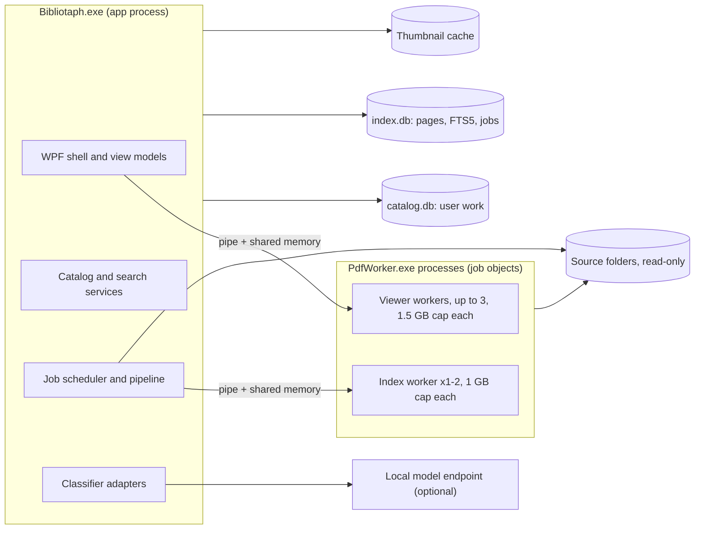

# Bibliotaph architecture

Version 1.0 · agreed by Dave on 8 October 2026 · companion to [product-spec.md](product-spec.md) (v0.3)

One WPF app on .NET 11, PDFium in a small pool of isolated worker processes, two SQLite files (user work in one, a rebuildable index in the other) with FTS5 search, and an in-process durable job queue.

The discussion copy, with comments, is the private [architecture proposal doc](https://claude.ai/code/artifact/c274b66e-807d-487b-af28-4707e03da9d0). This file is the version of record; change it by pull request.

## Decisions

| # | Area | Decision | Why | Alternative if it fails |
| --- | --- | --- | --- | --- |
| 1 | Target framework | .NET 11 (GA November 2026), self-contained; move to .NET 12 LTS in early 2028 | Standard-term releases get 24 months, so .NET 11 and .NET 10 LTS both reach end of support in November 2028 ([Microsoft](https://devblogs.microsoft.com/dotnet/dotnet-sts-releases-supported-for-24-months/)). The spike already runs on 11. | .NET 10 LTS |
| 2 | Process model | One UI process plus a pool of PDFium workers: one dedicated to the viewer, one or two for indexing, each in its own job object | A slow or hostile file being indexed can never stall the page being read | One shared worker |
| 3 | Storage | SQLite, two files: `catalog.db` (user work, migrated, backed up) and `index.db` (derived; upgraded in place when a schema change only adds, otherwise rebuilt), joined with ATTACH | Makes "rebuild never touches user work" (spec §10) a physical guarantee | One database with careful table ownership |
| 4 | Data access | EF Core for `catalog.db`; Microsoft.Data.Sqlite with parameterized SQL (Dapper for reads, reused prepared commands for bulk inserts) for `index.db` and search | FTS5's `MATCH`, `bm25()`, `snippet()` and `highlight()` have no LINQ translation, bulk page inserts need prepared commands in batched transactions, and `index.db` has no migrations. Values are always bound; the `MATCH` string is generated from the parsed query with every term quoted, and column names come from a fixed whitelist, since parameters cover neither. | Dapper everywhere, with hand-rolled migrations |
| 5 | Search engine | SQLite FTS5 (bm25, unicode61 tokenizer, diacritics removed); vectors for Release B later in the same index | Inside the 1-second p95 target for the collection; no second storage engine | Lucene.NET 4.8 |
| 6 | OCR | Windows.Media.Ocr behind `IOcrEngine`, running inside the index worker | Ships with Windows; no native binaries or language data to package | Tesseract 5, which lost the slice 1 bake-off: on 20 pages each of two scanned books Windows OCR scored 81% known words to Tesseract's 73 to 81%, recovered 99% of a digital book's words to 93 to 96%, and took about 250 ms a page to Tesseract's 1.6 to 3.5 s |
| 7 | Job queue | In-process, durable table in `index.db`, run by hosted services | Processing runs only while the app is open; a small scheduler is easier to reason about than a framework | A library queue if the scheduler outgrows that |
| 8 | UI toolkit | WPF with CommunityToolkit.Mvvm and Microsoft.Extensions.Hosting for DI; custom theme from the mockup tokens; no third-party control suite | The mockup is a bespoke editorial look, not Fluent | WPF-UI or the built-in Fluent theme as a base |
| 9 | AI adapter | Local first: an OpenAI-compatible endpoint (Ollama, LM Studio) behind `IClassifier`; endpoint and model configurable | Keeps text on the machine and costs nothing per book. The risk is the 95% precision gate, so the pilot measures it before anything is auto-applied. | Cloud adapter if local precision falls short on the pilot |
| 10 | Content identity | SHA-256 over the whole file, with NTFS file IDs to spot moves without rehashing | The spike hashed a 782 MB book in 456 ms; disk reads dominate, not the algorithm | XxHash128 if hashing shows up in profiles |
| 11 | Installer and updates | Velopack: per-user install, no admin, delta updates from GitHub Releases | Works with an unpackaged WPF app and native PDFium binaries | MSIX |
| 12 | Repository | Public `munkycdev/bibliotaph` under GPL-3.0-or-later (`LICENSE`, third-party notices in `THIRD-PARTY-NOTICES.md`); `spikes/` holds each spike in its own folder (`spikes/pdf-feasibility/`), committed for reference; `docs/` holds the spec and this design | | |

## At a glance

Everything except PDFium runs in the app process. The scanner in the app reads source folders to hash them through the same read-only reader the workers use.

## Process model and isolation

| Runs in | What | Why there |
| --- | --- | --- |
| `Bibliotaph.exe` | WPF shell, view models, catalog and index access, search, job scheduler, classifier adapters, backup | One place owns the databases; no IPC for ordinary work |
| `PdfWorker.exe`, viewer workers | Open, render, tile, find-on-page, character boxes for the documents being read | One per window showing a PDF, up to three (a fourth window shares the least busy, see 4a); never shares a queue with indexing |
| `PdfWorker.exe`, index slots (1 by default, 2 on "use more resources") | Probe, per-page text, covers, OCR of flagged pages | OCR needs a rendered bitmap; keeping it next to PDFium keeps large bitmaps out of the UI process |
| `aiworker\llama-server.exe`, only while the built-in AI has work | llama.cpp's server running the built-in AI's model | A native crash or running out of graphics memory takes down only that process; see Built-in AI under Metadata and classification |

Each worker keeps the spike's contract: length-prefixed messages over a named pipe, pixels through a shared memory section, a job object that caps committed memory (1.5 GB for the viewer worker, 1 GB for index workers) and kills the worker if the app dies, and a per-request timeout after which the worker is killed and restarted. Additions for the real app:

- **One process per job object, no children.** `JOB_OBJECT_LIMIT_ACTIVE_PROCESS` = 1. A low-integrity token is a later hardening step.
- **Poison-file memory.** The host records which file and page killed a worker; after two kills on the same page the job fails with that reason, so one bad book cannot loop the queue (A18).
- The message format moves from JSON to a versioned binary or MessagePack format only if profiling shows JSON costs real time.

## Solution layout

| Project | Kind | Holds | References |
| --- | --- | --- | --- |
| `Bibliotaph.Core` | Class library | Domain types (Document, FileLocation, PageRef, Assertion, Collection, SessionPack, Capability), query AST, policies; no I/O | Nothing |
| `Bibliotaph.Catalog` | Class library | EF Core context for `catalog.db`, migrations, backup and restore, JSON and CSV export, reading and applying library sync records | Core |
| `Bibliotaph.Index` | Class library | `index.db` schema, page and FTS5 writers, search and facet queries, query parser | Core |
| `Bibliotaph.Processing` | Class library | Source scanner, file watcher, reconciliation, job queue, pipeline stages | Core, Catalog, Index, Pdf.Host |
| `Bibliotaph.Classification` | Class library | `IClassifier`, rule-based hints, prompt and schema versions, evidence validator, adapters | Core |
| `Bibliotaph.Pdf.Contracts` | Class library | Worker messages and framing (from `Spike.Contracts`) | Nothing |
| `Bibliotaph.Pdf.Host` | Class library | Worker pool, job objects, shared sections, restarts (from `Spike.WorkerHost`) | Pdf.Contracts |
| `Bibliotaph.PdfWorker` | Console exe | PDFium and OCR (from the spike's `PdfWorker`) | Pdf.Contracts |
| `Bibliotaph.Viewer` | WPF control library | Virtualized page surface, tiling, highlights, text selection, image viewer (from `ViewerPrototype`) | Core, Pdf.Host |
| `Bibliotaph.App` | WPF exe | Shell, screens, view models, theme, DI composition | Everything above except PdfWorker |

Tests live under `tests/`: unit tests for Core, Index (in-memory SQLite) and Classification; integration tests for Pdf.Host against generated fixtures; and an acceptance harness, grown from the spike's `Harness`, that drives scenarios A01 to A18 against a corpus manifest.

Build-enforced rules: Core and Pdf.Contracts reference nothing; only App knows about WPF windows; only Processing and Pdf.Host open source files, and only through one read-only `ISourceFileReader` (a banned-API analyzer rejects write-capable `FileStream` and `File.Write*` calls elsewhere). The one exception is returning an online-only file to online-only (see OneDrive below), which changes only its local download state and lives in one small Processing class, `CloudFiles`, behind `ICloudFiles`. Processing already may use file APIs (it writes the extract cache), so the banned-API analyzer needs no allowance for it; the rule is kept by that class being the only caller of the cloud files API.

## Storage

Everything lives in `%LOCALAPPDATA%\Bibliotaph\`, never in a synced folder. Both databases run in WAL mode. A second PC gets the same user work through library sync files, not by syncing the databases (see Library sync below).

| File | Holds | On schema change | Backed up |
| --- | --- | --- | --- |
| `catalog.db` | Source roots, file locations, documents, proposed adventures inside files, metadata assertions, vocabulary, ignored folder labels, folder rules, corrections left unfinished, classification runs, collections, smart views (saved searches), pins, session packs, notes, Ask this book's conversations, rejections, settings, library sync state | EF Core migration, preceded by an automatic `VACUUM INTO` copy | Always |
| `index.db` | Pages (text, printed label, size, text quality, fingerprint), OCR word boxes for OCR'd pages, FTS5 tables, per-stage status, job queue, the entries the library lists (`entry_doc`), and a projection of effective metadata (`entry_meta`, `entry_facet`, `term_alias`), of which entries a model has read (`entry_ai`), and of the user's marks (`entry_scope`, `scope_name`, `entry_opened`) | An additive change runs its embedded `upgrade-N.sql` in a transaction; anything else, or a failed upgrade, drops and rebuilds, and documents re-queue from their content hash. Metadata is projected again from `catalog.db` at startup either way | Optional (spec §10) |
| `cache\` | Covers as JPEG files named by content hash; `cache\pages\` holds the reader's page thumbnails, a folder per book named by content hash with a JPEG per page drawn (whole books, least recently opened first, go past 256 MB); `cache\extract\` holds files from inside ZIPs, named by content hash, while they are processed or viewed (least recently used go past 5 GB) | Deleted freely | Never |

Core tables (full schema in slice 0):

- `source_root`: path, volume serial, availability (online, offline, removed by user).
- `file_location`: root, relative path, size, modified time, NTFS file ID, content hash, last seen, state (present, missing, online-only), and while new content at the path waits to be hashed, the document it held before (`previous_document_id`). `return_to_online_only` marks a file that was online-only when the hasher read it, until it has gone back (see OneDrive). A ZIP is a location with a hash and no document; each PDF or image inside it is a location of its own with the ZIP as `container_id`, its name inside the ZIP (`entry_path`) and CRC (`entry_crc32`), and a relative path that reads as File Explorer shows it (`Bundle.zip\Maps\Harbor.jpg`). Its state follows the ZIP's. `problem` says why a file inside a ZIP isn't read (a ZIP inside it, a password, too big, damaged), for Files needing attention.
- `document`: one row per content version: content hash, format, page count, capabilities with reasons, protection type.
- `entry`: one row per thing the library lists, which is what the user catalogs: kind (whole, part, pack, elsewhere), parent entry, created time. Every document is shown by one whole-document entry; a book owned elsewhere (in print, on a VTT) is an entry with no sources, its metadata the user's own assertions; an adventure inside a compilation is a part (slice 5, below). An entry joined into another as a copy keeps its row, pointing at the entry it joined (`merged_into_entry_id`), so Undo can bring it back. A pack has no sources of its own: each of its images keeps its whole-document entry, with its versions, hints and anything set on it, and points at the pack as its parent, which hides it from the library until the pack is split.
- `pack_decision`: a folder (the images directly in it) or ZIP (subfolders included) whose images are one pack, were split again, or wait in Needs review as a proposal: root, path, whether it is a ZIP, the answer (packed, split, proposed) and the pack's entry, made when the folder is first packed or proposed. Kept by path, so a rescan neither packs a split folder again, asks about it twice, nor loses a pack; it follows its folder or ZIP when that moves (see Packs).
- `entry_source`: which document an entry shows, optionally a PDF page range (for parts, with the fingerprints of the range's first and last pages), and whether it is the entry's current source. An entry has one current source, and a document has at most one whole-document entry. An entry with several whole-document sources has copies (identical text) or versions (new content at the same path); the current one is what opens, and when its files are all gone the newest copy with a file opens instead, without changing the choice.
- `entry_join`: each time Match or Same book joined one card into another, or Pack together merged one pack into another: both entries, the two documents (none for packs), and the rows that moved (as JSON, with a merged pack's images), so Not the same book and Undo can move them back.
- `elsewhere_match`: a file whose title matches a book owned elsewhere, with no publisher that says otherwise, found when the file is read, the book is added or either one's title or publisher changes: a "Is this its file?" card in Needs review while it has no answer. Same book joins the file's card to the book's (recorded in `entry_join` with the file as its own match, so Undo can part them) and the book becomes a whole entry; Separate book stays, so the pair isn't asked about again.
- `copy_decision`: pairs of content hashes the user said are not the same book, so Match never joins them or proposes them again.
- `version_proposal`: a "new version?" card in Needs review: the newer file, the file of the book it looks like a new version of, and why (pages in common, or title and publisher). One per file, for its best match; it goes once answered.
- `assertion`: entry, content hash of the copy a proposal came from (none for the user's own values), field, value as JSON, origin (embedded, folder, filename, rule, folder rule, AI, user), evidence pages, run ID, state (provisional, confirmed, rejected, superseded, awaiting a pending vocabulary term, or set aside from another copy's card). The effective value is a view over this table, never an overwritten column.
- `correction_request`: (entry, created) for each book whose Cataloged wrong… editor was closed without a change or a kept value: a "You said this book was cataloged wrong" card in Needs review until a correction is made in its details or It's fine now dismisses it (Undo restores the row with its date). One per entry, deleted with it; a card joined into another as a copy, or in a removed library folder, has no card.
- `folder_rule`: a folder rule (scenario review, row 8): library folder, folder path under it ("" for all of it), field, value in stored form, state (proposed, on, off), how many books it was proposed from, created and decided times. Unique per (root, folder, field, value), so a rule is proposed once and a declined one stays declined. Only a rule that is on gives suggestions.
- `favorite`: one row per entry marked with a heart, with when. A join moves it to the card the copy joined when that card has none, and Not the same book moves it back; a removed book owned elsewhere keeps it for Undo.
- `reading_state`: one row per entry that has been opened: when, which document, and the page an ordinary open was left at (search hits and session items keep no page). Another copy opening starts at the page that matches where the last one was left, and a version made current takes the place with it (slice 4h). Joins move it as they move a heart.
- `collection`: a collection's name, optional description, when it was made and last added to, and the collection it sits in (none at the top). Nested to any depth. Deleting one moves its sub-collections up a level first, and Undo puts it back with its id.
- `collection_item`: (collection, entry, when added) for each book added to a collection itself. A book in a sub-collection is in every collection above it through the tree, not through rows here. Joins move memberships as they move a heart, to every collection the surviving card isn't in already; a removed book owned elsewhere keeps them for Undo.
- `page_ref`: a page range: document (pages belong to content, not to entries), first and last PDF page, and the printed label and page fingerprint (index.db's `page.label` and `page.fingerprint`) of its first and last pages when it was made. Session pack items and page notes point here. Where a range opens in another version is worked out from these once that version has its fingerprints, and kept in `check`, `check_document_id` and the check's first and last PDF page: found, needs a look, or checked by the user (see `PagePlaces`).
- `session_pack`: a session's title, optional date, notes, when it was made and when it was last worked on (`touched_utc`). The pack touched last is the current one, which Add page and Add to session add to.
- `session_section`: a named heading in a pack (Adventure, Maps…), in order. Deleting one moves its items to the end of the section above.
- `session_item`: (pack, section or none, position, entry, page range or none, label, note, added). An item without a range is the whole book. Deleting the entry deletes its items; a join moves them to the surviving card (`MovedRows.SessionItems`), and a removed book owned elsewhere keeps them for Undo.
- `smart_view`: (name, definition, created, updated). The definition is JSON with a version, written and read by the app (`SmartViewDefinition`): the Library's search text, scope key, "only books added here", filters, order, layout and results tab. Never a list of books, so a view is the search run again.
- `pin`: the sidebar's Pinned group (Pinned Views plan): kind (Entry, Favorites, Collection, Binder, SavedSearch), position, and one nullable column per kind (`entry_id`, `collection_id`, `pack_id`, `smart_view_id`), each unique with a cascading foreign key; a CHECK makes the kind's own column the only one set, and a filtered unique index allows one Favorites pin. New pins go to the bottom. Deleting a target deletes its pin; the store that deleted it returns the pin's position, and Undo puts it back there, moving the pins after it down one. A join moves a book's pin like its heart, and Not the same book moves it back. A new catalog starts with Favorites pinned; the CatalogPins migration pinned Favorites, then the saved searches by name, then the pinned collections by name, and dropped `collection.pinned`.
- `note`: (entry, page range or none, text, created, updated). An entry has at most one note of its own (no range; a unique filtered index) and any number on its pages. Deleting the entry deletes its notes, and a page note's range goes with it. A join moves page notes to the surviving card, and its own note too when that card has none, otherwise appends the text after a blank line (`MovedRows.Note`, `NoteAppended`, `PageNotes`); Not the same book undoes it, stripping the appended text if it is still at the end. A removed book owned elsewhere keeps its own note for Undo.
- `sync_state`: library sync's memory of the user's work (library sync plan): one row per record key (`h:<hash>` for a book, `c:<sync id>` for a collection, and so on), its fields with each one's value and change time as JSON, the other keys a book answers to, a tombstone time once it is deleted, and whether it is pending (from another PC, and not usable here yet). `entry`, `collection`, `smart_view`, `session_pack`, `session_section`, `session_item` and `note` have a `sync_id` (a GUID, unique) that names a row the same way on every PC; the CatalogLibrarySync migration gave every existing row its own.

The UI reads through separate read connections; all writes to `index.db` go through one writer task that batches pages into transactions.

Classification runs live in `catalog.db` beside the assertions they produce, so a rebuilt index never loses a model's evidence or the record of what has already been classified. `index.db` holds only what search needs from metadata (version 16 of its schema). Pages, OCR, outlines, stage status and jobs stay keyed by document; what the library lists is keyed by entry:

- `entry_doc`: (entry, document, kind, copies, name, members, added) for each entry, the document it currently shows and how many files of the book it has. Probe writes it as soon as a document is added, and the metadata projection refreshes it. A pack shows its first image, and has its folder's or ZIP's name, the title until one is set, and how many images it has. A part has its parent and its first and last pages in the document its file shows, and a file how many parts it holds (`parts`); a part's page count is its range, and its cover is its first page, drawn by Covers into `page_cover`. A book owned elsewhere has no document and keeps when it was added; library queries join `doc` optionally, so it lists, sorts and is found by its metadata, is always in scope whichever folders are online, and never appears in Inside documents.
- `entry_member`: a pack's images in file name order (numbers as numbers), with each image's document, own entry and file name, for the mosaic of its first four covers, its inspector grid and stepping through it in the viewer.
- `member_fts`: the file names (without extension) of the images in packs, keyed by each image's own entry, so the Documents tab finds a pack by an image's name and says which image matched.
- `entry_meta`: one row per entry with the effective title, system and type labels, publisher, series, authors, tags, level range and state (known, n/a, unknown), how many players it is for (`players_min`, `players_max`, both null when unknown), whether anything is suggested, and how many Needs review cards it has (`needs_review`, a count), which the sidebar sums.
- `entry_facet`: (entry, field, value, label, confirmed, link) for the closed fields, behind the filter panel and field search. `link` is a linked field's web link (Also own and Get it from; the first, a confirmed one first, when a value has several), from index version 17; a card's online link is its first Also own row with one.
- `term_alias`: every name of every vocabulary term, so `type:module` finds adventures.
- `entry_note` (entry id, text) is the text of the entry's notes, its own note and then its page notes in page order, projected with its other marks after any of them changes; `entry_fts.notes` reads it, so search finds a book by a word in any of its notes.
- `entry_fts` (rowid = entry id) has an `authors` column; its `confirmed` and `provisional` columns carry the effective values as text.
- `entry_ai`: (entry, model) for each entry a model has finished reading, from its latest complete run. The library draws a spark on its cover, and the filter panel's AI choice (all, read, not read) uses it. A copy or version joined to an entry brings its runs with it, so the mark stays.
- `entry_scope`: (scope, entry) for each group an entry is in, keyed by name: `favorite`; `collection:12` for each collection a book is in, itself or through a sub-collection; `collection-own:12` for the collection it was added to, behind "Only books added here"; and `session:4` for each session pack with an item of it, behind a pack's "Show these books in the Library". The Library's scope (`LibraryFilter.Group`), `favorite:yes` and `collection:` read it.
- `scope_name`: (scope, name) for each collection's two scopes, so `collection:"name"` (whole name, or the start of one with `*`) finds its books, sub-collections included.
- `entry_opened`: (entry, opened) for each entry that has been opened, behind Home's Recently opened and the Recently opened order.

`MetadataProjector` writes these after rule hints, after every user edit, after each classification, after packing and once at startup in the background, one projection at a time, so one never writes back a card another has just taken away. A heart or an open projects only the marks (`ProjectMarksAsync`); a collection change projects the collections' names and the marks of the books whose collections changed (`ProjectCollectionsAsync`); a session change projects the marks of the books it added or took out.

`page_vec` (page id, model, version, vector) holds Ask this book's vector for each page, as little-endian float32s, under the embedding model that made it and the version of the text it was made from (`EmbeddingText.Version`). Triggers drop a page's vector when the page goes or its text changes (a page probed again with the same text keeps it). Only vectors of the current model and version are read; the first fill after the model changes in Settings deletes the book's others.

## Files, identity and the processing pipeline

A document is a content hash; a path is where that content was last seen. That gives duplicates (A01), moves (A06) and revisions (A08) without special cases.

**Discovery.** A full scan at startup and on demand; a `FileSystemWatcher` per root feeds the same reconciler while the app is open, debounced until size and modified time stop changing. A path whose size, modified time and NTFS file ID are unchanged is not rehashed. On a local drive every file's ID is read again each scan, so a file saved over another with the same size and date is seen; on a network share only new and changed files' IDs are read, since each is a round trip. A new path whose file ID, size and modified time match a location no longer at its own path, in this folder or missing from another, is that file moved, and keeps its location, hash and card. Where the disk keeps no file IDs (FAT and exFAT, as on most USB sticks), a file that left one path and arrived at another in the same scan of a folder, with the same name, size and modified time, is taken as moved when nothing else in that scan could pair with either; a renamed file, or two that could be swapped, is hashed and finds its card by its content. An unreachable root, or one whose volume serial changed, is marked offline as a whole; its files are never marked missing because of it (A07). Opening a book whose file can't be reached, from the Library, Home, a pin, Recently opened or a binder, shows the reader's prompt (`AwayFile`, from `PagePlaces.AwayAsync`): a book in an offline folder names the folder and its drive ("Plug in the drive to read this book."), and Try again scans that folder (`IndexingService.ScanNowAsync`, which returns once the pass has finished) and opens the book if it is back; a missing file says which folder it was last in, with Find it, which scans every library folder, and Show last folder. A binder's dimmed item says the same in one line.

**ZIPs.** A ZIP in a library folder is read through the read-only reader with System.IO.Compression and never unpacked beside itself. The hasher reads it once for its own hash, lists its PDFs and images, and hashes each new or changed one as it decompresses; a ZIP saved again keeps the hashes of members with the same name, size and CRC. A ZIP moved (found by its file ID, or as above) isn't read again: the files that went missing with it come back with it. Those are the files seen with it when it was last seen, since a read ZIP's files are seen at each scan that sees it; one found gone from it at an earlier read stays missing, and a ZIP with no such file is read again. A ZIP that comes back at its own path is still read again. A file inside a ZIP joins documents by its hash like any file, so a book loose and zipped is one document, and the loose file is read in preference. Stages and the viewer get a path from `SourceFiles`: the file itself, or the member extracted to `cache\extract\` and checked against its hash; a member that no longer matches blocks the stage until the ZIP is read again.

**Packs.** After each hashing pass that read something, and at the first start, `PackStore` looks at every folder and ZIP: one with 20 or more images and no PDF becomes a pack named after it, unless it was split, and images new to a packed folder or ZIP join its pack. A library folder's top level is never packed. "Split into separate images" gives each image its card back and is remembered; Undo packs it again. A folder or ZIP with 5 to 19 images, or 5 or more beside PDFs, is proposed instead: Needs review asks "Make these 12 images one card?" with Make a pack and Keep separate, each with Undo; fewer than 5 never ask, and a proposal that grows to 20 images with no PDF is packed by itself. A pack gets rule hints from its folder's names, as if an image sat directly in it, with its name as the title; AI doesn't read packs. Plain words in a search also match the names of the images in packs; the pack is the result, its card names the image, and opening it opens that image. The Kind filter (books, images, packs) replaces the format filter; `format:` stays for finer control. A pack's folder or ZIP that moves keeps its pack: when a scan follows its files, a split or proposed folder's decision moves with them (all of its images went to one other folder and none is left, and no decision is there already), so a split folder isn't packed again nor a proposal asked twice; a packed one is followed by `PlanAsync`, which moves the decision to a folder or ZIP whose images are all in that pack when its own place holds none any more, which also catches a move found only by hashing, and projects the pack again. A copy of a packed folder, whose images are all in the pack already while the original is still there, gets no pack of its own.

**Owned elsewhere.** "Add a book I own elsewhere" (under the Library's Owned elsewhere button, beside "Import from an online library") makes an entry with no file from a title and optionally a game system (or edition), type, publisher and Also own. Also own is a multi-value term field on every card (vocabulary `own`: Print, Foundry VTT, Roll20, D&D Beyond, Fantasy Grounds, Alchemy, and the user's own), searched with `own:` and filtered in the panel; only the user sets it, so neither folder names nor AI suggest it. The card has a placeholder cover marked Elsewhere and nothing to open; its inspector says there is no file, lists Also own first and offers Remove from library with Undo.

**Online libraries, O1 (online libraries plan).** Also own is a linked field (`FieldKind.Store`, like Get it from): each value is a place, with the book's page there after a space ("dnd-beyond https://www.dndbeyond.com/sources/…"). Starter vocabulary 6 gives the online places their sites as names (dndbeyond.com, roll20.net, demiplane.com, and so on) and adds Demiplane and Shard Tabletop, so a link typed alone is filed under its place; a link to a site the vocabulary doesn't know names a place of the user's own after the site ("example.com"). A place given bare and with a link is kept once, with the link. A card's first Also own place with a link is its online link (`LibraryEntry.OnlineLink`, `OnlineLabel`): a book owned only elsewhere opens it in the default browser from Open (through `IShellLauncher`, without asking, since only the user puts it there), and any card with one offers "Open on D&D Beyond" in its menu and details. The cover's badge, bottom left, says where the book is, its online place first, with the site's own icon (`SiteIcons`, Processing: fetched once from the site's /favicon.ico into `cache\icons`, one file per site, a site with none asked again after a week; `SiteIconImages` in the app decodes them) or a cloud while there is none or Settings > Library > Show site icons is off, which also stops the fetching. The Library's kind filter has On this PC beside Owned elsewhere, and `where:here` and `where:elsewhere` search the same. Match offers a new file with the book's title as its file (`elsewhere_match`). The other way round, `ElsewhereService` checks the files already in the library when a book is added, and again whenever cards' metadata are projected, so a title or publisher changed on either side, and every card at startup, is checked by the same rule (`IndexQueries.GetElsewhereFilesAsync`, one pass over `entry_meta`); a pair asked about before isn't asked again.

**Online libraries, O2 (online libraries plan).** Library > Owned elsewhere > Import from an online library opens the Online libraries page, which imports the books the user owns on an online service as books owned elsewhere. A reader per service (`IOnlineLibraryReader`, Processing) turns that service's library page into `OnlineBook`s (title, link, publisher, type, system, edition, year, cover address) and counts the books shared with the user, which are left out. It reads only the page it is given and fetches nothing. `DndBeyondReader` reads the Next.js data D&D Beyond's page carries (`self.__next_f.push` chunks, joined, then each `"sources":[` list parsed as JSON), not its markup: the catalogue with `isOwned` and `isSharedWithMe` per book, every owned book whichever tab is showing. `OnlineImports` previews a page (`PlanAsync`): a book whose link is already on a card (matched by site without "www." and path, ignoring case and a last slash) was imported before and fills only its empty fields (Update, or Unchanged); else a card with its title and no publisher that says otherwise gets the place and link (Add to card), its bare place replaced by the linked one; else it is New. A page that is the whole library also lists the books owned elsewhere linked on that site that it no longer shows, each with Remove from library; nothing goes on its own. The import (`MetadataStore.ImportAsync`) writes every ticked row in one transaction: new entries with their values as the user's own confirmed assertions, quoting "Imported from your D&D Beyond library on 11 Oct 2026", and changes to existing cards as bulk edits with field snapshots. Its receipt is the message bar's Undo: the new entries go with their covers and the cards get their snapshots back. A type or edition the vocabulary doesn't know is left out rather than made the user's own term. Covers are only ever images the page already has: for a saved page (Save as, Webpage complete), those in its "_files" folder, found by file name. They are thumbnailed into the cover cache as `elsewhere-<sync id>`, and the projection gives an elsewhere entry's `entry_doc.cover` from it (index schema 18), which library queries fall back to when there is no document.

**Online libraries, O2 in-app browser.** Each service's Open button on the Online libraries page opens `OnlineBrowserWindow`: WebView2 (Microsoft.Web.WebView2, BSD-3-Clause; the browser is the Edge WebView2 Runtime Windows 11 has, and the page says so when it is missing) with one environment and profile for every window in `%LOCALAPPDATA%\Bibliotaph\browser` (`AppPaths.Browser`, written only by the browser), so sign-ins last between imports and stay apart from the everyday browser. It opens the service's library page once and never navigates, clicks or scrolls by itself. After each page settles (DOM loaded, navigation completed or history changed, then 400 ms) it takes the page's HTML with `document.documentElement.outerHTML` and gives it to the reader; Read this page is enabled only when the reader recognises it, and sends the books to the Online libraries page, which shows the preview and comes forward. A second page read in the same window adds its books to the preview (`OnlinePage.With`, each book once by link). Covers are the images the pages loaded, kept from `WebResourceResponseReceived` (image responses only, 8 MB each, 64 MB a window; Next.js's `/_next/image?url=` is keyed by the original address) and looked up by address or file name; nothing is fetched for them. The site's icon (`FaviconChanged`, as PNG) goes to `SiteIcons.Keep` for the badge unless site icons are off. Sign out of all services closes the windows and clears the profile's browsing data through WebView2 (`CoreWebView2Profile.ClearBrowsingDataAsync`), so Bibliotaph deletes no file.

**Online libraries, O2b online reader.** A book owned only online opens from Open, a pin or a binder in the online reader (`OnlineReaderViewModel`, Route.OnlineReader, in the Library section), which is built like the PDF reader around the service's own page in WebView2, with the same environment and profile as the in-app browser, so it is signed in the same way. Around the page are Back, Forward and Reload for the site, the heart, the pin, the book's own note beside the page (not over it: the browser draws over anything laid on top), Add this page, Open in your browser and Pop out / Return to main window (`OnlineReaders`, through `ReaderWindows`). It copies no text from the page, so it has no search, page box, thumbnails, page notes or Ask. It follows links on the book's site and the sites its service signs in on (`IOnlineLibraryReader.SignInSites`: D&D Beyond's is wizards.com) and their subdomains; a link the user follows anywhere else, or one that opens a new window there, goes to the everyday browser and the reader says so, while a site's own redirects are let through. Settings > Library > Read books owned online in Bibliotaph (`library.online-reader`, "app" or "browser", on by default) sends them to the everyday browser instead, as does a PC without the WebView2 Runtime. Add this page puts the page in view (its address, with any #section) into the current binder or one from its menu, labelled with the page's title less the service's name; a binder item has a nullable `link` (catalog migration CatalogBinderLinks), library sync carries it as the item's `link` field, and `SessionsService.ResolveAsync` gives such an item `SessionItemState.Online`. A binder's list opens it, and a whole book owned only online, in the online reader at that page; At hand opens it in a reader window of its own; the binder's own reader shows it in the online reader in place of its file reader (`SessionReaderViewModel.Online`, a view made afresh for each page), so Next and Previous step between files and pages online, and the page's own Pop out is hidden there (`IsInBinder`), as the binder pops out. When such pages go to the everyday browser, the binder's reader says to open it from the list or At hand. The binder dialog hides the browser while it is open, for the same reason as the note.

**Online libraries, O5 downloads.** Online libraries > Downloads takes a downloads folder (`library.downloads-folder`), which must be a library folder or inside one (`DownloadPlaces.RootOf`, the innermost root, compared without case). When a page in Bibliotaph's browser or the online reader starts a download, which only the user's click on the store's own Download button does, `OnlineDownloads` takes WebView2's `DownloadStarting` (with a deferral) and points `ResultFilePath` at the downloads folder under a name nothing there has (`DownloadPlaces.FreePath`: " (2)", " (3)"… before the extension, also skipping a partial `.crdownload`), and marks it handled so the browser's own download bubble stays away. The browser writes the file; Bibliotaph's code still writes nothing into library folders. The browser window lists the session's downloads (name, progress, Cancel, Show in folder) and the reader says how its download went. A finished download asks for a scan of its library folder, besides what the folder watcher sees, and the file is read like any new one, so "Is this its file?" offers it to a book owned elsewhere by the same rule as any file. With no downloads folder, or one that can't be reached, the browser saves to the user's Downloads folder as usual and the list says so. The stores (Humble Bundle, DriveThruRPG, whose library is DMs Guild's too) have rows of their own, whose browser windows sign in and download as well as read the library (O4, below). A window a page opens (`window.open`, a `target="_blank"` Download button, a sign-in popup) is hosted by Bibliotaph (`OnlinePopupWindow`, WebView2's `NewWindowRequested` with `NewWindow` set) rather than WebView2's own window, so its downloads go to the downloads folder too and the opener keeps its handle for sign-ins; a tab that only downloads is hidden and closes when its file is saved. Every browser window has Save page, which writes the page as it shows (the document as drawn, with what the user chose in a list or typed in a search box written into it, never a password or a sign-in form, `SavedPages.SaveAsync`, no images) to a file the user picks: the way to bring a store's real library page to whoever builds its reader, without Edge's Save as.

**Online libraries, O4 readers.** Demiplane, Humble Bundle and DriveThruRPG have readers built against real library pages and tested on made-up ones (`OnlinePageReaders.cs`, fixtures in `tests/fixtures/online`). None of their pages carries data to read the way D&D Beyond's Next.js scripts do, so each reads its markup with `PageMarkup`: the page cut at a marker each book's markup starts with (`data-cy="source-card"`, `subproduct-selector`, `<obs-library-title-card`), and the title, link, publisher and image in each piece. `IOnlineLibraryReader.LinkField` says where a book's link goes: Also own for a service whose books are read there (D&D Beyond, Demiplane, which open in the online reader), Get it from for a store whose books are files to download (Humble Bundle, DriveThruRPG), so a book bought but not downloaded becomes a book owned elsewhere to get there, and "Is this its file?" offers the file once it is downloaded. Demiplane: each game has its own Nexus, whose Sources page shows the books as cards; only cards with the unlocked View button are read, and the page is never the whole library (one game's), so no book is listed as missing. Humble Bundle: the library lists every product with no page of its own, so it is read only with eBook chosen under Platform (`Hint` says so otherwise), and a book's link is the library with a slug of its title after `#`; `LinkKey` keeps the fragment, so books stay apart. A search typed in the library makes the page part of it. DriveThruRPG (`DriveThruRpgReader`) is DMs Guild's library too, one site for both stores, so DMs Guild has no row of its own and its site is followed as DriveThruRPG's: the product link and title, the publisher link, the thumbnail; links lose their query; a page with links to other pages is part of the library, each read adding its books. A saved page's images are its saved files (`./… _files/cover(1).jpg`): `SavedCovers` finds them by file name whether the page gives a web address or the saved file. In the live browser a cover is matched by address, then by the same address with another query, then by a file name only one image has. The browser looks at the page again when it changes without a new page (a filter chosen, more books drawn): a document-created script posts a message at most every 1.5 s on a change event or new markup. `RealLibraryPagesTests` runs the readers over a folder of real saved pages named by `BIBLIOTAPH_REAL_PAGES`, and says only file names and counts.

**Online reader, Reading mode and page labels.** A service's reader can carry a Reading mode stylesheet (`IOnlineLibraryReader.ReadingStyle`, choice 24): D&D Beyond's hides the site's menus, ads, page-header extras, quick actions and footer, and leaves the book's contents and table of contents. The online reader finds its book's service by the link's site (`OnlinePages.ServiceOf`) and, while Reading mode is on, adds a document-created script that puts the stylesheet in a `<style id="bibliotaph-reading">` once the page's DOM is ready, on the service's own site only (not the sites it signs in on), and on the page in view at once; turning it off removes the script and the style. The toolbar's Reading mode button shows only for a service with a stylesheet; the choice is one for every book (`library.online-reading-mode`, on unless "False"). Add this page labels a page with its title cut down to its own name (`OnlinePages.LabelOf`): the place, the service's name and its title tail (`TitleTail`, D&D Beyond's "Sources" and "Dungeons & Dragons") come off the end, then the book's title, matched as titles are, unless the page is the book's own.

**Same book.** In the Library's Select mode, Same book (multi-select plan, M1) joins two or more ticked cards for books or single images, with at most one book owned elsewhere, as one book; packs aren't offered. A copy and a new version are the same thing in the catalog, files on one card with one that opens, so one action covers both, and its dialog asks which file opens (the one found most recently, unless changed). Each card joins the oldest, or the book owned elsewhere when one is ticked, exactly as Match joins a copy (`EntryStore.JoinAsOneBookAsync`, one transaction): what it brings moves, and a value that disagrees is set aside for a Copies disagree card. A "Not the same book" given for any two of the files is forgotten, and a waiting "new version?" card for them stops showing because its files are on one card. Undo in the message bar takes every card back out with what it brought and remembers the forgotten answers again; later, Not the same book in the Copies list takes one back out, as it does for Match.

**Pack together.** Select mode's Pack together (multi-select plan, M2) puts two or more ticked cards for single images or packs into one pack, with one dialog for the pack's name. Images alone make a pack by hand: an entry of kind Pack with no `pack_decision`, which doesn't grow by itself and whose details list the folders and ZIPs its images are in. With one pack ticked the images join it, and a folder pack stays one: its folder's new images still join it. With several, the newer packs merge into the oldest exactly as a copy's card joins another (`EntryStore.MoveAsync`, recorded in `entry_join` with no documents and the merged pack's images), so hearts, collections, binder items, notes and values move; the merged pack keeps its entry, marked merged, and `PackStore.PlanAsync` follows the mark so its folder's new images join the pack it merged into. The dialog's name becomes the pack's own title when the pack is new or merged, or was renamed. Undo puts everything back, the title included. Split into separate images frees every image and marks every folder behind the pack, merged ones too, as split; its Undo puts those images back.

**Check a download.** The Library's "Check a download" page checks a folder (with its subfolders and ZIPs) or one ZIP against the library without adding anything. Each PDF and image is hashed through the read-only reader: a hash with a file in a library folder is Already owned. Other PDFs are read in the index worker for their page text and fingerprints, which the Match rules compare with `page.fingerprint` in index.db (Another copy, Maybe a new version), and then their rule-hint title and publisher are compared with the cards' (Owned elsewhere, Maybe a new version). Images are judged by hash only. A PDF inside a ZIP is read from a temporary copy in `check-*` under the extract cache, removed when the check ends. Nothing is written to catalog.db, index.db or the job queue; Copy list puts the results on the clipboard as tab-separated text.

**OneDrive.** Online-only files (recall-on-data-access attribute) are always indexed, which downloads each as the queue reaches it. Local files are queued first, first run shows how many files and how much data will download, and online-only files wait while downloading the next would leave less than 2 GB free on its drive. Once a file that was online-only has been read, Bibliotaph returns it to online-only, so a library larger than the disk can be indexed (Dale's review, row 2; decided by Dave, 10 October 2026). Settings > Processing has "Return files to online-only after indexing", on by default.

- *Which files.* Just before the hasher reads a file it asks the file's attributes again; one that is online-only then is about to be downloaded by Bibliotaph and is marked (`file_location.return_to_online_only`), whether or not the setting is on, so turning it on later gives back what indexing downloaded meanwhile. A ZIP is marked as a whole; its files go back with it. A file already on this device when it was read is never marked, and a changed file loses its mark until it is read again. The mark is this computer's: a restore or "Point to its new place" clears it, and the JSON export leaves it out.
- *When.* A marked file goes back once it has been hashed and every document read from it (its own, or each file inside a ZIP) is done with it: queued, with no Probe, Text, Covers, RuleHints or OCR job waiting or running (`JobBoard.DoneReadingAsync`). Blocked and failed stages don't keep it, a stage waiting to retry does, and Classify and Match never do since they read stored text. A small loop in `IndexingService` looks whenever a file stage finishes, a batch is hashed, a lane pauses or the setting changes, and every couple of minutes.
- *Never.* A file the user pinned ("Always keep on this device", the pinned attribute) stays and loses its mark; so does one the platform refuses. A file open through `SourceFiles` (a book in the reader, a ZIP being extracted) waits until it closes. Opening a book afterwards downloads it, as Windows always does, and nothing marks it again.
- *How.* `CfSetPinState(CF_PIN_STATE_UNPINNED)` from cldapi.dll, on a handle opened for attributes only. Microsoft documents it as callable by any application, not only the sync app, and it is what Explorer's "Free up space" does: the sync app then drops the local copy when it can, and not while another app has the file open. Content, path and timestamps never change. `CfDehydratePlaceholder` was not used: it needs an exclusive handle and is the sync app's own call. The returned location reads as online-only in the catalog straight away.
- *With the low-disk pause.* While online-only files wait for space, a lane that is paused no longer keeps its books' files (they go back, and download again when it resumes), and each file returned wakes the hasher, at once and again 15 seconds later, since the sync app frees the space shortly after it is asked. Space given back lets the waiting files download, so a library bigger than the disk is indexed in turns rather than stalling.
- *Other sync apps.* Dropbox needs no code of its own: where its online-only files are cloud files placeholders (they then carry the recall-on-data-access attribute the scanner already looks for), they are marked and returned by the same code. It is untested, and if Dropbox ignores or refuses the pin state the file simply stays on this device, logged. Google Drive for desktop streams through its own drive letter and cache rather than placeholders: its files never read as online-only, so they are left alone, and Drive manages its own cache.

**Stages**, each with its own status (pending, running, complete, partial, blocked, failed, skipped):

1. Fingerprint: SHA-256; a known hash attaches the new path to the existing document and stops. A ZIP is read for its members here.
2. Probe: page count, protection, permissions, page labels, outline, embedded metadata, capabilities.
3. Text: per-page text and text quality; pages with no or garbage text are flagged for OCR. The document is searchable from here (principle 6).
4. Cover and thumbnails.
5. Rule hints: folder names, the file name and the PDF's own information become provisional assertions in `catalog.db`. A folder name counts only when it matches a vocabulary term or alias, and each such folder label can be switched off in Settings > Library folders; a folder rule that is on (see Easier corrections) suggests its value, with origin folder rule, for every file in its folder and below, the deepest rule winning a single-value field; an edition implies its system; the deepest folder wins for single-value fields; junk embedded titles and authors ("Microsoft Word - final2.doc") are skipped; levels and party sizes ("for 4-6 players", "for four to six characters", "a party of 4", "solo") are read from the file name, title and subject only. Where to get it (Get it from, scenario review, row 7) comes from a store named in a folder name, the file name, the PDF's producer (`doc.meta_producer`, read by Probe from index version 14; files read before that have none until they are reprocessed) or a watermark line, and only the store is kept: the quote is the store's name as matched. Watermark lines (`Watermarks` in Core) are lines that read like one ("Prepared exclusively for…", an order or transaction number, an email address) or short lines that repeat on half the pages; they are found in memory, matched against the store vocabulary and dropped, never stored, logged or sent anywhere. Hints usually run before a file's text is in, so Match, which runs after Text, reads them again and projects only if the watermark changed them. Re-running replaces the document's earlier hints and never touches a value the user decided.
6. OCR: flagged pages only, page numbering preserved (A05).
7. Match: waits for the document's OCR, then fingerprints each page from the stored text (lowercase letters and digits only, with lines that repeat on half the pages dropped, so per-buyer watermarks and running headers don't count) and looks the fingerprints up in `page`. A document with the same page count and every page's fingerprint equal (at least 3 pages, and at least half of them, fingerprinted) is the same book: the newer card joins the older one as a copy. Its user values come along, a single-value field the two cards confirmed differently keeps this card's value and sets the other aside (`SetAside`) for a "Copies disagree" card in Needs review, and the joined copy does not become current. A remembered `copy_decision` stops the join. Otherwise a file is proposed as a new version of the book it shares the most pages with, when that is at least 60% of the smaller file's fingerprinted pages, or else of a book with its title and publisher; the user makes it current, keeps it as another copy, or says it is a separate book. Match also waits for the document's hints from names, which give the title and publisher. No PDF is read again, so the stage backfills existing libraries at startup.
8. Classify: in its own lane, one book at a time, only while AI is set up and switched on. It waits for the book's OCR, skips books in a folder kept from AI and content the current model and prompt version have already read, and stores what passes the evidence check as AI suggestions. While the endpoint isn't answering, the job goes back to waiting and the lane retries every minute with a notice ("Cataloguing with AI is waiting"); nothing is marked failed and the other lanes carry on (A14). An answer that isn't JSON is a failed run, retried with the usual backoff. So is a book the server takes but fails on (a 5xx, such as Ollama's "token repeat limit reached" when the model loops, or no answer in the time allowed) while the server still answers a small check request sent straight after; if the check fails too, it is the endpoint's problem and the lane waits as above. One book can't hold up the rest. Classify is counted apart from indexing, so "Up to date" and Needs review's files list ignore it.

**Job queue.** A `job` row per document and stage: priority, attempts, not-before time, lease owner, stage version. Jobs are idempotent by content hash, stage and stage version. On startup, stale leases return to pending (A11). Opening a document moves its pending jobs to the front. Concurrency is per lane (index workers, rate-limited classifier); pause is per lane. Disk-full or credential failures block the lane with one visible notice.

**Revisions.** Changed content at a path creates a new document that joins the old document's entry as its current version (the old one stays as a copy, and Not the same book splits it off). Until the new version has its page fingerprints, places on the old one say it is still being read and nothing is judged changed. Then each session item and page note is looked for in it by fingerprint: found ones open, and are listed, at their page there; the rest open at the same printed page marked "This page changed: check it", and one Needs review card per version lists those, with Use this page. Using a page there, or its Undo, shows at once where the place is open (`PagePlaces.SessionItemMoved` and `PageNoteMoved`, passed on by `SessionsService.Changed` and `NotesService.PageNotesChanged`): an open binder's list and reader follow the item without being opened again, and a reader showing the place in the same file drops or brings back its banner and Use this page; a reader showing it in another file, such as the one its pages were added from, keeps that file until the place is opened again. Where the book was left moves to the matching page.

## Search

- **Parser.** A hand-written parser in Core turns `chase "through a city" type:adventure level:3` into an AST. Errors carry a position so the UI can underline the bad token and keep the query. Smart Views store the AST.
- **Documents tab.** `entry_fts` over title, subtitle, publisher, series, authors, tags, notes and effective metadata, with bm25 column weights; confirmed and provisional values in separate columns so ranking can prefer confirmed.
- **Fields.** `publisher:`, `author:`, `series:` and `tag:` match their `entry_fts` columns. `system:` (system or edition), `edition:`, `type:`, `setting:`, `theme:` and `environment:` match a term by key, label or any alias through `entry_facet` and `term_alias`, with `*` prefixes. `style:` and `duration:` are term fields too (scenario review, row 6), and so is `store:` (alias `from:`), which matches Get it from by any name of its store (row 7). `level:3` and `level:2-4` match overlapping ranges, `level:none` books with no levels, and `level:unknown` books nobody has levelled; `players:4` and `players:3-5` match books whose party size overlaps (`players:"four to six"` reads too), and `players:unknown` books with none. Any field takes `unknown` and `-`. `where:here` and `where:elsewhere` (online libraries, O1) keep the books with a file on this PC or those owned only elsewhere. `length:` says it isn't searchable yet.
- **Ask** (scenario review, row 5). A button beside the search box switches it to Ask: the box takes a request in plain English ("Mothership, level 4, jungle world with terraforming"), typing doesn't search, and Enter has the AI read it, through `PlainSearchService` (Processing) and `AiSettings.Interpreter`, over the same client as the classifier (the built-in AI or the model server). `PlainSearchPrompt` (Classification, prompt version 1) is guarded as the classifier's prompt is: the system message holds the rules, the fields Ask may fill (`PlainSearchPrompt.Fields`: the search fields whose values a model can know, so not tags, collections or folders) and the vocabulary's names; the request goes only in the user message, cut to 500 characters, inside `<search-request>` tags, with anything like the tag altered; and the answer can only fill a schema of filters (`field` from an enum of those fields, `value`, `exclude`) and words (`text`, `exclude`). `PlainSearchCheck` checks every piece: a field the search box doesn't have is dropped; a vocabulary value must name a term (an edition named as the system goes under `edition:`), or it becomes words when the user typed them and is dropped otherwise; words and free-text values must be the user's own words or the start of one ("terraform" for "terraforming"); levels and players must parse; a one-value field keeps its first value; words a filter already covers go; and a level asked with a game system or edition whose books are all marked as having no levels (`GetSystemsWithoutLevelsAsync`: at least one book with levels n/a and none with known levels, as there is no flag on the system) is ignored. Each kept piece must parse with the search box's own parser, and every change is a note ("Mothership has no character levels in your library, so level 4 was ignored."). A panel under the top bar shows the pieces as chips (field and an editable value, or words, each with ×) with the notes; Search puts them in the box as ordinary query text (`QueryClause`) and runs it. Nothing runs before that, explicit filters are never loosened and nothing unknown is filled in (spec §4.2); there are no embeddings. With AI off the search box works as before, and Ask says it needs AI, with a link to Settings > AI. Logs get counts, never the request.
- **Inside documents tab.** `page_fts` is an external-content table over `page.text`, so `snippet()` quotes the indexed page. Hits are grouped and limited per document in SQL.
- **Highlights.** Not stored; when a hit opens, the viewer worker runs find-on-page for the query terms on that page.
- **Facets.** An `entry_facet` table (entry, field, normalised value, confirmed or provisional) refreshed when assertions change; counts are `GROUP BY` over the current result set excluding the facet's own dimension. Levels are system-scoped min and max; unknown is a real value (A12).
- **Coverage.** Results can show "searching text in N of M documents" (A02).

Estimated scale (not measured): roughly 150,000 pages and 350 MB of text for the current 488-PDF collection. Slice 1 measures search latency on the real collection.

## Viewer

The spike's viewer becomes `Bibliotaph.Viewer`, designed so a page never waits for a full-quality render.

1. **Preview first.** A fast render at about a quarter of the target scale, replaced by the full render. Scanned pages decode the whole image at any scale, so their preview comes from page thumbnails cached after first view.
2. **Prefetch and cancel.** Two pages ahead in the scroll direction; requests for pages scrolled out of view are dropped.
3. **Zero-copy hand-off.** `Imaging.CreateBitmapSourceFromMemorySection` over a small ring of shared sections per viewer worker, to avoid copying bitmaps out of shared memory. Needs a proof before it is relied on.
4. **Tiles above 200%.** 512-pixel tiles with an LRU memory budget.
5. **Labels and position.** "Printed p. 42 · PDF page 46 of 180"; last reading position stored separately from search jumps.
6. **Text selection and copy.** For each visible page the viewer worker returns character boxes with the bitmap. Drag to select, double-click for a word, triple-click for a line, Ctrl+A for the page, Ctrl+C copies the selected character range as PDFium extracts it. OCR'd pages select against stored OCR word boxes. If the PDF forbids copying, Copy is disabled with the reason shown.
7. **Thumbnail strip.** The toolbar's Page thumbnails button shows a strip under the pages with a thumbnail of every page (`PageStripViewModel`, in the main window, pop-outs and the binder's reader); it is hidden at launch and then stays as last left for the sitting (`ReaderWindows.ShowsStrip`), not saved, like Contents and Notes. The page in view is outlined and kept in sight, a page with notes has a badge (at the pages Go to opens each note at in this copy; `PageStrip.NoteCounts` in Core), and the pages of a binder item opened from a binder or its list (`SessionItemOpen`, not a whole book) have a bar over them, with the rest of the book still in the strip. A click, or Enter on the focused thumbnail (arrow keys move along it), goes to the page; the mouse wheel scrolls it sideways. It is a horizontal virtualized list that scrolls by whole thumbnails, and only the thumbnails in view and four either side are drawn (`PageStrip.PagesToDraw`); one scrolled away stops waiting and pictures far off are let go. `PageThumbnails` keeps about 400 decoded in memory, then reads `PageThumbnailCache` (`cache\pages\`, 144 px wide), then has the viewer worker draw the page through the open document's `PdfRenderer` in an idle lane (`RenderWhenIdleAsync`) that runs only while no page render is waiting.
8. **Reading ahead across books.** In a binder, once an item shows, `ReadAhead.Next` (Core) picks the next item when it's a PDF in another book (the book open draws its own next pages, item 2 above). `ViewerViewModel.PrepareAsync` opens it on the same viewer worker with a password that opened it before (never asking), and the view draws the page the item opens at, at the size it will show at (`PdfPagesView.PrerenderAsync`; a page that would be tiled is drawn at preview size). Next takes that open document and page (`PageSeed`) as they are, so the page shows at once with no second open. One book is kept ahead; it closes when the next item changes, the binder closes or the reader leaves.
9. **Links.** A page's link annotations are read by the viewer worker (`Links`) when the pointer first reaches the page: a link shows a hand cursor and a tooltip ("Go to page 42", or the web address). Clicking a page link jumps there and the toolbar offers Back to page …; a web link opens in the browser after asking (http, https and mailto only). A page with no links of its own whose text lists printed page numbers, as a plain-text index or contents page does, gets links made from them (`PageReferences`, over the numbers' character boxes). A number counts only at the end of a line after an entry's words (with a comma, colon, dot leaders or a space between), or alone on a line that carries on an entry ending in a comma, and only on a page that plainly lists pages: eight or more such lines that are most of its lines, four or more after dot leaders, or, under an "Index" or "Contents" bookmark or heading, three or more that are at least half its lines. Sentences, dice (2d6, 1d20 + 5), stat lines (AC 15), table rows counting up from 1 (1–2, 3–4, 5–6), copyright lines and numbers with a leading zero never count, and a range ("34–36") links to its first page. A number finds its PDF page through `PrintedPages`: the page labels, when any label is a plain number (a number two pages share finds nothing); otherwise the numbers printed at the top or foot of the book's pages in its indexed text, when at least three pages, and half of those showing a number, agree on the offset (a page showing the number itself wins within 10 pages, so a few unnumbered plates don't throw the rest off); otherwise no links are made, since PDF page n is seldom printed page n and a wrong jump is worse than none. A number that isn't one of the book's printed pages (a year, usually) gets no link. The tooltip says "Go to page 34", adding "(PDF page 36)" in a book without labels, where the rest of the reader counts PDF pages.
10. **Known gaps.** Highlight and selection placement on rotated pages; non-ASCII paths, addressed by loading through `FPDF_LoadCustomDocument` with a read-only .NET stream.

JPG, PNG and WebP open in an image surface with zoom and pan, decoded at a capped pixel size. WebP goes through Windows' own decoder, which needs Microsoft's free WebP Image Extensions; without them a WebP lands in Files needing attention saying so.

## Metadata and classification

- **Effective value.** Computed per field by `EffectiveMetadata` in Core, never stored. Origins rank user 100, folder rule 60, AI 50, rule 30, embedded 20, folder 15, file name 10: the user agreed to a folder rule, so it outranks a model, but it stays a suggestion. For a single-value field the latest confirmed value wins and is never replaced (A04); otherwise the best-ranked suggestion applies and the rest are alternatives. For a multi-value field (types, styles, themes, authors, tags) the value is every confirmed value, plus the top-ranked origin's suggestions that arrived after the user's last decision there; everything else is an alternative, so a field the user settled stays settled until something new is suggested. A closed field (a vocabulary term or levels) needs review when an alternative arrived after the last decision; free text never does by itself.
- **Hints and decisions.** Rule hints are replaced on each run by diffing, so an unchanged suggestion keeps its age. "Keep this" confirms the suggested values, "Use this" makes an alternative the value, typing a value stores a user assertion (a term field resolves the text through the vocabulary or adds the user's own term), and "Reset" returns the field to its suggestions.
- **Easier corrections** (scenario review, row 8). Cataloged wrong… on a card's menu (Library and Home) or in the details opens the details in a correcting mode: every field shows, a value nobody confirmed carries a Guessed mark with its evidence open, and a banner explains what to do, with Done. Done, closing or replacing the details, or leaving the Library ends it: with no change or kept value (`CorrectionService.LeaveUnfinishedAsync`) the book gets a `correction_request` and a Needs review card whose Fix it opens the details again in that mode; with one, any card it had goes. After a value is typed, chosen or rejected in the details (in any mode), `CorrectionService.FindLookAlikesAsync` looks for look-alikes and the details ask "Change 14 other books from “Fey Court” too?". A look-alike (`LookAlikes`, deliberately narrow) is another whole-book card with a present file directly in the same folder as the corrected book's current file (not a subfolder), whose field shows exactly the values the corrected one showed before (the same guess, or nothing), and that the user hasn't settled there; title, year and Get it from are a book's own and never offered. Change them repeats the correction as one bulk edit (`MetadataService.EditManyAsync`, slice 4e): a value given is Set, a value removed or rejected is Remove (allowed on a single-value field, where it rejects the guess) and a value added to a list is Add; the Library's bulk banner says what changed and its Undo takes it all back. Folder rules (`FolderRules`): after the user decides values (typing, choosing, keeping, or in bulk), a folder where at least three books directly in it have the same decided value for a field gets a proposed rule, unless the folder's own names already suggest it or the rule was proposed before; per-book fields never do. Needs review shows it ("You set system Pathfinder on 3 books in this folder. Suggest it for every file in it?"); Use this rule switches it on and reads the hints of every file in the folder and below again, so they get it as a suggestion and new files do too; No thanks keeps it off. Both can be undone, and Settings > Library lists the answered rules with a switch each. Switching on a rule for a single-value field switches off the folder's other rule for that field.
- **Rejections.** Stored as (document, field, normalised value); they suppress that value from any origin and any later model.
- **Needs review.** `MetadataReview` in Core decides the cards (slice 2 plan, choice 4): a closed field whose sources disagree, and a document with no usable title (none, or one like "IMG 0042"); with "Review all suggestions" in Settings, also every value nobody has confirmed. A card shows the current value, the suggestion and its evidence. Accept confirms the suggestion; Reject rejects what the card proposes and confirms what the field showed; Edit stores what the user types. Every decision is undone from a snapshot of the field's assertions and rejections taken before it. "Accept all" takes every card proposing the same values for the same field. Suggestions refresh the page only on request, so decided cards keep their Undo.
- **New terms.** A classifier's term the vocabulary doesn't know becomes a pending term, and its values are held (`AwaitingTerm`) out of the effective metadata. Needs review shows one card per term: Add makes it a term and its values suggestions; Map files it under an existing term, whose aliases gain its name; Reject rejects the term and its values, and the same name proposed again is dropped. Each can be undone.
- **Input.** A bounded excerpt of about 24,000 characters (choice 9): the first three pages with text, the last two pages with text among the final four (the back cover, where "for 4–6 characters of levels 3–5" and the blurb usually are; scenario review, row 6), up to two contents pages, the introduction (from the outline, else a page that opens like one) and the page after it, then pages sampled evenly across the rest; plus top-level headings. Watermark lines are left out of every page first (scenario review, row 7), so a buyer's name and order number never reach a model. Each page follows a `[Page N]` marker (N counts from 1). The system message holds the rules, field definitions and the vocabulary's names and nothing from the book; the user message holds the file name, up to three worked examples, and the excerpt inside `<book-excerpt>` tags. Worked examples (scenario review, row 8) are the user's own books, chosen by `WorkedExamples` (Classification) through `ExampleFinder` (Processing): books with a file in the same folder first, then books with the same game system, then the same publisher, the latest decided first among equals; a book alike in none of these isn't sent. Each is one line of the values the user confirmed in the classifier's fields ("- title: …; system: Pathfinder; type: Adventure"), as term names, neutralised like the book's text, a value cut at 100 characters and all of them at most 1,500 characters (about 400 tokens), never any text from a book. A book with a file in a library folder kept from AI is never an example. They are marked as other books whose values and quotes must not be used, and the evidence check still only accepts quotes from this book's pages. Examples are library data, like the vocabulary's names, so the prompt version stays the same and nothing is read again; the model pilot sends none, so its runs stay comparable. Each run records provider, model, prompt version, schema version, content hash, pages analysed and outcome in `classification_run`.
- **Output.** A JSON schema with one array per field (title, publisher, authors, series, year, system, edition, type, levels, players, duration, setting, style, themes, environments), each item `{value, page, quote}` and nothing else; an empty array is unknown. Your tags are never filled by AI. Adding a field later is a new entry in `ClassifierPrompt.Fields` and a prompt version bump; the schema, parsing and evidence check follow from that list.
- **Evidence check.** A claim stands only if its quote appears in the indexed text of the page it cites, compared as letters and digits only after compatibility normalisation (so case, spacing, line-break hyphens, ligatures, accents, punctuation and quote style don't matter; an ellipsis splits a quote into parts that must appear in order; at least 8 letters and digits). For printed values the quote must also name the value: the title (before any colon), an author, the series, the publisher, the year, the levels' or players' numbers (as digits, or as words up to twelve: "for four to six characters"), or any name or alias of the system, edition or setting (a system also through one of its editions). Types, duration, styles, themes and environments are judged from what a passage describes, so their quote only has to be on its page. Values must parse (years, level ranges), and closed fields resolve through the vocabulary: an unknown edition is dropped, any other unknown name of five words or fewer becomes a new-term card. Two different values for a single-value field cancel out; an edition brings its system when the system is missing and is dropped when it contradicts it. Claims from sampled pages are marked as such.
- **Untrusted text (A16).** The excerpt goes in a delimited data block, and anything in the book that looks like the closing tag or a page marker is altered so it isn't one. The adapter exposes no tools, the response can only fill the schema, keys outside it are ignored, and its values become suggestions only after the evidence check. Nothing in an answer can change a setting, a tag or a user decision. Logs get counts and reasons, never book text or quotes.
- **Ask's prompt** (scenario review, row 5). A second prompt, `PlainSearchPrompt`, reads a search request in plain English through the same adapter, guards and schema-only answer; see Ask under Search.
- **Adapters.** One adapter over `HttpClient` and System.Text.Json, no SDK (choice 8). Connecting tries Ollama's `/api/version` and `/api/tags`, then an OpenAI-compatible `/v1/models`. A request without a schema (Ask's prose answers) sends no `format` or `response_format` and isn't retried. Ollama is asked through its native `/api/chat` with the schema as `format`, temperature 0 and `num_ctx` sized to the prompt (8K to 32K tokens); other servers through `/v1/chat/completions` with a strict `json_schema` response format, falling back to `json_object` when a server refuses that with a 400. The Classify lane streams the answer (Ollama's JSON lines, or server-sent events), so AI reading can show it as it comes; Test and the pilot don't. A server error line part way through a stream counts as a 5xx. Never a fallback from local to cloud.
- **AI reading** (Built-in AI plan, choices 12 and 13). A page in the main window, opened by "See what the AI is reading" in Processing and in Settings > AI. `AiReadingFeed` (Processing, a singleton) holds the book the Classify lane is reading and the last 20 read, in memory only. The page looks at it four times a second and shows the book, the step (waiting for the model, reading the excerpt, writing), a progress bar while llama.cpp's server reads the excerpt (`return_progress`; Ollama doesn't report it), and the answer's fields as they are written (`PartialAnswer` reads the unfinished JSON with `Utf8JsonReader`, keeping values whose text is complete). Each finished book shows what the evidence check kept, with page and quote, and what it threw away and why, or why the book failed. A book the endpoint never read (it was down) isn't listed. Book text reaches only the page, never the log.
- **Built-in AI** (Built-in AI plan). Bibliotaph can run the model itself, so nobody has to install a model server. It ships llama.cpp's `llama-server` (MIT, the Vulkan build, which runs on Nvidia, AMD and Intel cards and falls back to the processor) in `aiworker\` beside the app. `build/fetch-engine.ps1`, verify.ps1's Engine step on Windows, downloads the release pinned in `build/engine.json` and checks its SHA-256, keeps only `llama-server.exe` and the libraries it loads, and writes `engine.txt` with the version; with no SHA-256 pinned it fails printing what to pin, which is how the pin is moved on. A copy built without that step downloads the same pinned release itself: at every start until it has one, `BuiltInEngineDownload` fetches it from GitHub in the background (whether or not the built-in AI is used), checks the SHA-256 against `build/engine.json` (embedded in Processing), keeps the same files, and puts them in `%LOCALAPPDATA%\Bibliotaph\engine`, which Start over leaves. The engine beside the app always wins over a downloaded one, and a downloaded engine of an older pin is replaced. A failed download is logged, shown in Settings > AI, and tried again at the next start; the finished one wakes the Classify lane. `BuiltInEngine` (Processing) starts the server on first use with the model file, on 127.0.0.1 and a free port, with a one-time key passed in its environment (`LLAMA_API_KEY`) so no other program can use it, `--parallel 1`, `--jinja` and no web UI, waits for `/health` to answer 200 (it answers 503 while loading), and sends requests through the same OpenAI-compatible adapter as any server. One request at a time. The context starts at 16K tokens and the server restarts with more when a book needs more, never with less for the same model. It stops after 5 idle minutes, when the Classify lane is paused, when AI is switched off or moved to a model server, and when the app closes; a job object with no memory cap makes sure it never outlives the app. A server that exits while loading reports its last output lines; one that exits mid-answer fails that request as a `ModelRequestException`, so the book fails alone (as above) and the next request starts it again. Requests add a 2,048-token answer cap and switch Qwen3's thinking off (`chat_template_kwargs`); there is no repetition penalty, since the evidence check needs the book's words quoted exactly. Runs are recorded with provider `built-in` and the model's name plus " (built in)", so they count as a different model from the same one on Ollama. `AiSetup` keeps the built-in choice and model (`ai.built-in`, `ai.built-in.model`) beside the model server's settings, so switching back and forth loses neither. `BuiltInModels` lists the models offered, each pinned to a Hugging Face revision, file, size and SHA-256: Qwen3 8B (the default, for 7 GB of graphics memory or more) and Qwen3 4B, both Apache-2.0. Models are kept in `%LOCALAPPDATA%\Bibliotaph\models`, outside backups, and Start over leaves them. CI runs the real server on a 260K-parameter test model on the processor. `BuiltInModelDownloads` downloads a model only when Download is pressed, to `<file>.part`: it checks there is room for the rest plus 512 MB first, resumes with a Range request after Pause, a dropped connection or a restart (starting over when the server ignores the range), and renames the file only once its SHA-256 matches; a file with the pinned name and size counts as downloaded. One download at a time, in the background, so it outlives Settings. Pressing Download sets the built-in AI to that model, so until it arrives the Classify lane waits saying the model isn't downloaded yet, and the finished download wakes it. Delete model stops the engine first. Ask this book's built-in embedding model runs in a second `BuiltInEngine` (keyed `embedding` in the container) with `--embedding` and a batch as big as its 2K context, so a page is read in one go, with its own idle stop; it also stops when AI goes off, moves to a model server or loses its embedding model, but not when the Classify lane is paused, since Ask is asked for rather than background work; `BuiltInEmbeddingClient` sends it the OpenAI-compatible embeddings call. Its model (nomic-embed-text v1.5, Apache-2.0) isn't pinned yet, so it isn't offered for download: `BuiltInModelDownloads` refuses any model without a revision, size and SHA-256. `GraphicsMemory` reads the largest display adapter's memory from the drivers' registry values (`HardwareInformation.qwMemorySize`, else `MemorySize`), since WMI's figure stops at 4 GB; the largest model that fits is suggested, the smaller one when nothing is known.
- **Settings > AI** (choice 10). A choice at the top between Built in and Use a model server (Built-in AI plan, choice 7); Built in shows first for anyone who hasn't set AI up. Built in lists the models with size, graphics memory and the suggested one chosen, the chosen model's licence with a link, Download (with progress, Pause and Cancel download), Test with a book and Delete model; a downloaded model is used as soon as it is chosen, and the first model set up switches AI on. Use a model server is the page described next; saving a server there switches to it, and switching either way keeps the other's settings. AI is off until an endpoint and model are saved; the first save switches it on, and an On/Off switch keeps the setup while sending nothing. The page lists the endpoint's models (or takes a typed name), keeps a key in Windows Credential Manager (`Bibliotaph:ai:` plus the endpoint) and never shows it again, and has a Test button that opens a popup, classifies one book with what is on screen, says which step it is on (picking a book, reading it, waiting for the model) with a seconds count and Cancel, then shows each kept value with its page and quote, and what was dropped and why. Switching On before an endpoint and model are saved springs back, says why under the switch and puts the cursor in the address box. An endpoint off this computer and its network needs "Send excerpts to this server" ticked. Each library folder can be kept from AI. Changing the model or prompt never reclassifies on its own: the page counts books an earlier model or prompt read and offers "Reclassify N", which gives every book back to the lane (those already read by the current model and prompt are passed over). Home asks once, after the first folder, whether to set AI up now or later. Library folders shows "Cataloguing with AI" as a step with Pause AI. A model server's section also has "Embedding model, for Ask this book" (`ai.embedding.model`), listing the server's models with None (find passages by their words) first; the built-in section has its own embedding model (`ai.built-in.embedding`) with Download and Delete. The remote warning says the pages of a book asked a question would go too.
- **Ask this book** (Ask plan, Q1: find by meaning). An Ask button in the reader's toolbar, shown only for a PDF while AI is ready, opens a panel on the right (Notes and Ask take turns). `AskService` (Processing) finds the pages of the open book that answer a question without asking a model to write anything. Words: the question's words, less stop words, as an FTS5 `OR` of quoted prefixes (`AskRetrieval.WordsMatch`, so nothing typed becomes syntax) against `page_fts`, scoped to the book. Meaning: the question's vector (`search_query:` prefixed for nomic models) against each page's in `page_vec` by cosine. The two rankings (30 deep each) are fused by reciprocal rank (k = 60), and a page under a bookmark that has one of the question's words gains half a first place, which reorders pages found but brings none in. A weak-signal guard marks the question as not in this book when the best page by words has fewer than half its words and, with vectors, the best cosine is under 0.45 or under 0.05 ahead of the median; then no evidence is chosen and the panel names the pages that came closest. Otherwise up to 8 pages, 4,000 characters each and 24,000 in all, become the evidence the answer step will read. The panel lists the passages ("p. 112 · The Mill", a few lines around the first word found, the word as the page spells it) as links that open the page with that word marked by Find, and says how many pages have text and await OCR, and whether pages were found by meaning. The first ask of a book with an embedding model set starts filling its vectors in the background, 8 pages at a time (each page sent as its bookmark plus its text, cut to 3,000 characters, `search_document:` prefixed for nomic models), one book at a time; until it is done, pages are found by words and the vectors so far, and the panel says how far it has got. Without an embedding model it finds by words alone. Pages go only to the configured endpoint, only while AI is ready (so a remote one needs its tick), never from a folder kept from AI, and the log counts pages, never their text. A server that can't make the question's vector leaves words finding pages and the panel says why.
- **Ask this book: answers** (Ask plan, Q2). Unless the weak-signal guard stopped it, the question and the chosen pages go to the chat model in Settings > AI (the model server, or the built-in AI), with no schema, a 12K context and a 1,024-token answer cap. `AskPrompt` puts the rules in the system message and nothing from the book: answer only from these pages, [p. N] after each claim, the book's exact words in double quotation marks, point at a table rather than copy it, and reply with exactly "The pages I was given don't answer that." when they don't (the second guard). The user message has the question, then the pages inside the same guarded `<book-excerpt>` block classification uses, each after `[Page N]` (N the page as the reader numbers it, with its PDF page added when two pages sent share a number) and its heading, neutralised as classification's excerpt is. The answer streams into the panel and `AskAnswerCheck` checks it as it comes (it works on an unfinished answer, and drops a `<think>` block and Markdown's bold marks): each [p. N] (also "pp.", "page", lists and ranges) to a page that was sent becomes a link; one to any other page is removed, and a sentence left without a citation it had is marked "(not on the pages it read)"; each quotation is looked for, with `EvidenceCheck`'s normalisation, on the pages its sentence cites (any page sent when it cites none), and one that isn't there is shown in italics without its marks; a word or two in marks can't be checked and stays. A citation opens its page in the viewer with the quotation's first words marked by Find, else the word the page was found by. Under the answer, "Read from pages 112, 113 and 140" heads the passages. Stop ends the answer where it is. "Ask this book" in a card's menu (Library and Home) and in the details, shown only for a PDF with text while AI is on, opens the book with the panel showing (`ViewerRequest.Ask`). The log counts pages, tokens (estimated), citations and quotes, never text. The smoke test drives all of it against `SmokeModel`, a stand-in server at `http://smoke-model` registered only with `--smoke-test`.
- **Ask this book: conversations** (Ask plan, Q3). Each answered question is kept with its answer as the book's conversation, in catalog.db's `ask_turn` (entry, time, question as typed and as rewritten, answer, its checked pieces as JSON, cited PDF pages, model, whether the pages answered it), so a rebuilt index keeps it. `AskHistoryStore` keeps the last 50 turns of a book; deleting the entry deletes them. The panel lists the earlier turns above the latest, with their citations still links, and reopening the book lists them again. A follow-up (any question after the first) first goes to the chat model with only the last three turns and the rules for making it stand on its own (`AskPrompt.RewriteSystemMessage`; no page of the book, a 4K context, a 120-token cap); the rewritten question finds the pages, and the panel shows it as "Looked for: …" when it differs. A reply that isn't one line of question, or a server that fails, leaves the follow-up as typed. The answer then goes with the same three turns, citations taken out and each answer cut to 600 characters, before the question, and a rule that they only make the question clear. New conversation forgets the book's turns. "Forget its text" forgets them too, since they quote the book. The log counts turns, never their text.
- **Model selection (slice 2d pilot).** Starting the app with `--pilot` adds a Model pilot section to Settings > AI. Pick books chooses 100 PDFs with text on at least three pages, round robin across top folders and game systems with a fixed seed, never from a folder kept from AI, and writes them to `books.txt` (document number, tab, path), which the user may edit; each run reads it again. Start has each listed model, in order, read each book it hasn't, through the saved endpoint, with the Classify lane paused until it ends; Pause stops after the current book and Start carries on. A bad answer is that model's failure for that book; a timeout or refusal is too if the server still answers, and a server that is gone stops the run. Everything goes to `pilot.db` (runs with seconds and failures, every kept and dropped claim with page, quote and reason, the user's answers), never to `catalog.db`. The Pilot review page shows one book at a time with, per core field (title, game system, type, publisher, levels), the kept values of every model and the catalog's values merged and sorted alphabetically with no model named; the user uses one, types an answer or ticks "Not in this book", and by default the answers also become the user's own catalog values. Scoring (`PilotScoring`, pure): values match through the vocabulary, a title matches its own main title before a subtitle, publishers match without "Inc.", "LLC" and the like, levels as ranges; a single-value field counts only the first kept value, as the Classify stage would store it. Precision is right values over values stored, coverage is answered fields filled completely and correctly, both over title, system, type and publisher; the correction rate is answered books with any wrong core value. Gates: precision at least 95%, coverage at least 70%, corrections under 20%. Make the report writes `report.html` with the gates, per-field counts, median seconds, failures and each wrong value. The pilot folder is `%LOCALAPPDATA%\Bibliotaph\pilot`, outside backups and the repository; the architecture document records only the numbers. The most precise passing model, then the fastest, becomes the default offered in Settings > AI; if none passes, AI stays opt-in and a cloud adapter is considered only then.
- **Vocabulary.** Starter vocabularies with aliases and parent terms in `catalog.db`; new model terms go to vocabulary review unless they match an alias exactly. Settings > Vocabulary adds terms, renames them (the key stays, and the old label becomes an alias) and adds or removes aliases. A name means one term per vocabulary: taking another term's alias moves it, with a note saying so, and another term's own name is refused. Seeding adds starter aliases only to terms new in that starter version, so a removed alias stays removed. After an edit pauses, the library catches up in the background: every document is projected again, then the hints from names run again for every document. Starter version 3 (scenario review, row 6) adds Style (heist, dungeon crawl, hexcrawl, exploration, investigation, monster hunt, wilderness) and Duration (one-shot, short for 2–3 sessions, long for 4 or more, campaign) as vocabularies, and genre-neutral environments (jungle, ruins, space, station, starship, alien world). Themes keep tone and subject: the catalog migration `CatalogStyles` moved the starter themes that name a kind of adventure (heist, dungeon crawl, exploration) to Style with their keys, values, rejections, switched-off folder labels and saved searches asking for them by key, and took hexcrawl and pointcrawl from exploration, jungle from forest and investigation from mystery, so the new terms own those names. Players is a single, closed field of its own kind (`PlayerRange`: "4", "3-5"), shown as "4–6 players" and filtered in the Library by a number of players; Style and Duration filters appear once a book has one, and the CSV export has Players, Duration and Style columns. Get it from (row 7) is a multi-value field of its own kind (`FieldKind.Store`) on the entry, so every copy and version shares it: each value is a store from the `store` vocabulary (starter version 4: Kickstarter, BackerKit, DriveThruRPG, itch.io, Humble Bundle or another bundle, Publisher's site, Bundle of Holding, Game On Tabletop, Other store; a store's site, such as "drivethrurpg.com", is one of its names), stored as its key with an optional http or https link after a space (`StoreLink`). Typing a link alone files it under the store whose site it is on, or Other store; any other kind of link is refused. The inspector shows each link as a button that opens it in the browser only after asking, as a PDF's web links do (`WebLinks`); the editor and bulk edit take "DriveThruRPG https://…", the Library filters by store, entry_facet holds one row per store, the CSV has a Get it from column with the links, and no model suggests it. A system with no levels is marked n/a on Levels, as before.

## UI shell

- **Routes.** Home, Library, Collections, Sessions, Needs review, Reading, plus first-run source setup, as in the mockup. A back stack restores search, filters, selection and scroll position when leaving the reader. The sidebar's Pinned group (Pinned Views plan) lists the pins in order; `PinDirectory` keeps them in memory with their targets' names for the sidebar, Home and every Pin button, and `PinOpener` opens one: a book in the reader where it was left (its details when it has no file; one whose folder is offline or whose file has gone opens to the reader's prompt), Favorites or a saved search in the Library scoped to it with a chip whose × shows the whole library, a collection's page, or a binder's reader. A page's `PinKey` tells the sidebar which pin to mark; with none marked, the main item for its `NavRoute` is. Pin and Unpin are on a book's menu, details and reader, and on the collection, binder, Favorites and saved-search pages; the sidebar item's right-click menu has Move up, Move down and Unpin. A pin is dragged to a new place in the sidebar, with a `DropLine` adorner where it will land, or moved with Alt+Up and Alt+Down; `PinStore.MoveAsync` renumbers every pin in one save, and the keyboard stays on the pin that moved. The main navigation stays put while the Pinned group scrolls on its own, and long names are trimmed with the whole name as the tooltip. The Library's Saved searches button lists every saved search, pinned or not, each with its pin, Rename and Delete (with Undo). In the UI a Smart View is called a saved search; the code keeps the SmartView names. A collection's Library page sits under Collections (its `NavRoute` and breadcrumb). `CollectionDirectory` keeps every collection in memory for the pages and fills each card menu's Add to collection items as it opens; each page has its own `CollectionActions` for the collection dialog and the note with Undo. Settings > Library > Start on picks Home or the Library at launch.
- **Library filters.** The Filters panel shows game system, type, character level and players; More filters opens the rest in groups (the adventure: style and duration; where it lives: source folder, Also own and Get it from; housekeeping: kind, AI, copies and adventures inside files), and says how many of them are on while folded. The filters that are on show as chips under the toolbar whether the panel is open or not (`LibraryViewModel.ActiveFilters`), each with a × that turns it off, plus Clear filters once there are several; the Filters button counts them.
- **MVVM.** CommunityToolkit.Mvvm source-generated view models; services from the generic host's DI container.
- **Theme.** The mockup's tokens become brush resources in Light and Dark dictionaries, following the Windows app mode unless overridden.

| Token | Light | Dark |
| --- | --- | --- |
| `bt-bg` | #f9f8f5 | #1d211f |
| `bt-panel` | #fffefc | #242925 |
| `bt-side` | #f0f0e9 | #181d19 |
| `bt-line` | #e3e5dc | #383f38 |
| `bt-text` | #232b26 | #e8ece6 |
| `bt-muted` | #70766d | #adb6ab |
| `bt-accent` | #365847 | #aec9a9 |
| `bt-accent-text` | #fcfcf7 | #1c3023 |
| `bt-soft` | #e4eadd | #303e30 |
| `bt-warm` | #efe8dc | #433c30 |

- **Type and icons.** DM Sans for the interface, Libre Caslon Display for display headings only, both embedded (SIL OFL). Lucide icons as `Geometry` resources (ISC).
- **Cover grid.** The MIT-licensed `VirtualizingWrapPanel` package; covers decoded off the UI thread at display size and frozen.
- **Accessibility.** Per-monitor DPI v2, automation names on every control, keyboard paths for every action, and a 200% scaling pass in slice 0 (A17).
- **Accessibility in CI (slice 4k).** The smoke test checks every page and dialog it visits for automation names, controls cut off at the minimum window size, and a Tab order that reaches every control. A Windows contrast theme swaps in a third palette from the system colours, live; every animation is off when Windows' animation effects are; Ctrl+/ lists every shortcut.
- **Shortcuts.** Ctrl+K global search, Ctrl+F in-book search, Enter open, Esc close.

## Safety, secrets, packaging and updates

- **Source files.** Read-only by construction: one reader, the banned-API analyzer, and the before-and-after hash check as an acceptance test on every corpus run. The one exception, returning a file that indexing downloaded to online-only, changes no byte, name or timestamp and is confined to `CloudFiles` (see OneDrive).
- **Passwords.** The unlock prompt has "Remember this password" (off by default) and "Make its text searchable" (on by default). A remembered password is keyed by content hash, so it survives moves and covers duplicates, and lets the index worker process that book unattended. One entered without Remember stays in memory for the sitting only, lent to the index worker while "Make its text searchable" is ticked. Settings > Passwords lists remembered passwords with Forget and Forget all. A locked book's card says "Locked: open it to unlock"; a file that forbids copying is still indexed, with Copy off in the reader.
- **DRM.** A PDF whose security handler PDFium can't open (error 5) fails Probe for good: its card says "Protected" and "Can't be read here", it keeps editable details, and the reader, the inspector, the card menu and Files needing attention offer Open in another app (the default app, by shell execute; a file inside a ZIP opens its ZIP).
- **Secrets.** Saved passwords and API keys go to Windows Credential Manager, local to the machine (not roaming), under a `Bibliotaph:` prefix; never in the databases, logs, exports or prompts. Purge derived content (spec §8) is "Forget its text" on the card menu: a flag in catalog.db (`document.text_forgotten_utc`) stops indexing the book, and its pages, FTS rows, outline, jobs and cover go from index.db in one transaction, with its cover file, its page thumbnails, AI runs, undecided suggestions and Ask this book's conversation (the reader keeps a forgotten book's thumbnails in memory only); "Read it again" clears the flag and reprocesses it.
- **Logs.** Rolling files in `%LOCALAPPDATA%\Bibliotaph\logs`; page text and passwords are never logged.
- **Backup and restore (slice 4j).** A backup is a zip of a `VACUUM INTO` copy of `catalog.db`, and of `index.db` when "Include the search index" is ticked, with `manifest.json`: app version, catalog schema, the library folders (path, volume, file count) and counts of the user's work. Settings > Backup saves one on demand, and one is made in the background at the first start of each week, into `backups\`, keeping the last four automatic ones. Secrets are never in it. Restoring reads the zip into a staging folder (an older catalog is migrated there; a newer one is refused), shows each library folder as Found or Not found so a moved one can be pointed to its new place, and restarts. At the next start, before any database opens, `PendingRestore` keeps the current catalog as `catalog-…-before-restore.db`, swaps the restored one in and drops `index.db` unless the backup carried one; a missing folder comes back offline. Volume serials and file IDs are cleared, since they belong to one machine, and the index is rebuilt in the background without hashing files again (A15). Export writes a CSV of the books (one row each, for spreadsheets; cells that look like formulas are kept as text) or a JSON of every catalog table; the Library's Select mode exports the ticked books as CSV. The code is `Backups`, `PendingRestore` and `Export` in Processing, over `CatalogFile` and `CatalogExport` in Catalog.
- **Library sync (library sync plan).** Bibliotaph stays a desktop app with no sync service: the same user work reaches a second Windows PC through a folder the user picks in Settings > Backup > Sync with another PC (one in OneDrive, say). Each PC writes only its own file, `<folder>\Bibliotaph sync\<PC name>.json` (`SyncFile`, Core: a format name and version, the PC's name and a machine id kept in settings, and the records), and reads the others'. The databases never go there, and Settings refuses Bibliotaph's own data folder or a folder inside it (`LibrarySync.CheckFolder`). What travels: metadata decisions per field (the values kept and the ones rejected), hearts, a book's own note, page notes, collections and memberships, saved searches, binders with their sections and items, pins, active vocabulary terms, Not the same book answers and books owned elsewhere. What doesn't: library folders and file locations, reading places and Recently opened, settings, joins, version and pack decisions, AI runs and suggestions, and caches. Library files are never touched. Books are matched by content hash (a card's key is its lowest hash, its other copies' hashes are aliases, so a PC with only one copy finds it); what the user made, by `sync_id`. `LibrarySyncStore` (Catalog) reads all of it as records of named fields (`SyncSnapshot`) and applies a set of changes in dependency order, each in its own save, under `CatalogWrites.Quiet()`; what it can't apply is reported, never half applied. `LibrarySync` (Processing, a hosted service) runs a pass: it stamps what changed on this PC since the last pass against `sync_state` (a field that differs gets the time it was noticed, and always a time after the value it replaced, so a PC whose clock is behind still wins over what it overwrote), merges the other PCs' files (`SyncMerge`, Core: per field the newer change wins, equal times settle on the greater value; a deletion wins over every change made before it, so deletions propagate through tombstones, which are kept), applies the result, stamps again, saves `sync_state`, and writes this PC's file if it is behind (to a `~$` file, then moved in). Work on a book this PC doesn't have is kept pending, never written back out and never read as a deletion, and applied when a file with that hash shows up; work done here meanwhile is kept as the newer change. Merging is idempotent, so reading the same files again changes nothing and writes nothing. `CatalogWrites`, an EF Core command interceptor on `catalog.db`, notices writes to the user-work tables and has the file written 5 seconds after the last (at most a minute after the first); the file is also written at close. A merge runs 3 seconds after start, 3 seconds after another PC's file changes (a `FileSystemWatcher` on the folder; this PC's own file is ignored), every ten minutes for a folder that was offline or a change the watcher missed, and on Sync now. A folder that can't be reached, a file that can't be read or comes from a newer Bibliotaph, and another PC with the same name (told apart by the machine id; this PC then stops writing) show in Settings' status line, which otherwise reads "Last merged from DESKTOP-2 at 09:14". After a merge that changed anything the metadata is projected again and the shell reloads collections, saved searches, binders and pins.
- **Installer (slice 4l).** Velopack (MIT, pinned in `Directory.Packages.props`), per-user with no admin, self-contained win-x64 (win-arm64 later): the app, and the PDF worker in `pdfworker\` beside it, each carry .NET. Pack id `BibliotaphApp` installs into `%LOCALAPPDATA%\BibliotaphApp`, which uninstalling deletes, apart from the library in `%LOCALAPPDATA%\Bibliotaph`; a test fails if `AppPaths.PackId` and `AppPaths.FolderName` ever meet or the release workflow packs with another id. `Program.Main` runs `VelopackApp.Build().Run()` before anything else, for Velopack's install, update and uninstall hooks. Unsigned for now: Windows shows "unknown publisher" once; sign before sharing beyond Dave and Dale.
- **Releases (slice 4l).** A tag `vMAJOR.MINOR.PATCH` (from 1.0.0; before that `v0.N.P`, N the slice) runs `.github/workflows/release.yml`, the only workflow with `contents: write`: `build/verify.ps1` with the smoke test, `dotnet publish` of the app and the worker with the tag's version, the licence texts, `vpk download github` of the latest published release (so a delta package is made; none the first time), `vpk pack`, and a draft GitHub Release with Setup.exe, the full and delta packages and a `releases.win.json` of just those. Dave presses Publish. Local builds keep `Directory.Build.props`' version (1.0.0).
- **Updates (slice 4l).** `UpdateService` (behind `IUpdateService`; the smoke test has its own) checks the repository's published releases with Velopack's `GithubSource`, never drafts or pre-releases, at start and every 24 hours, and downloads in the background. A downloaded update shows in the sidebar as "Update ready: restart to update"; its click starts Velopack's updater, closes the app the usual way so the databases close, and the updater applies the update and reopens it. Nothing restarts by itself mid-session; an update downloaded but not applied is applied at the next start. Silent offline, on errors (logged) and in builds that weren't installed. A build from a fork's release workflow updates from that fork (`ReleasesUrl` in the App project).
- **Licences.** The app is GPL-3.0-or-later; every dependency is permissive (`THIRD-PARTY-NOTICES.md`). A new package must be permissive or GPL-3.0-compatible: no AGPL (MuPDF, iText, Ghostscript), no revenue-gated licences (ImageSharp, QuestPDF). The build copies `LICENSE`, `THIRD-PARTY-NOTICES.md`, the OFL files, Lucide's licence, llama.cpp's and LLVM OpenMP's (for the built-in AI's `libomp.dll`) into the app's `licenses\` folder, and `tools/LicenseNotices` (verify.ps1's Licenses step, and the release workflow on the published app) writes `licenses\packages\<id>.txt` for every package in the app's and the worker's `.deps.json`, the .NET runtime included: the package's licence and notice files from the NuGet cache, or the standard text for its SPDX id from `tools/LicenseNotices/texts/`, and `pdfium.txt` from the pdfium-binaries notices kept per PDFium build. It fails on an unknown licence or one off its list of GPL-3.0-compatible ones (MIT, Apache-2.0, BSD-2/3-Clause, ISC, Zlib, LGPL, GPL-3.0, SQLite's public-domain blessing; not MS-PL, which the FSF lists as GPL-incompatible); the Windows SDK projection the worker uses for OCR is the one exception, shipped under a GPL section 7 additional permission (`LICENSE-EXCEPTION.md`, copied into `licenses\` too). The About popup (4f) shows the version, the Bibliotaph copyright, the GPL's no-warranty line and links that open those files, so the GPL's "Appropriate Legal Notices" are in the UI and forks keep them.
- **PDFium.** Pin the PDFiumCore version, check for new builds each release, keep worker isolation as the second line of defence.

## Spike results and open risks

Gates from the PDF feasibility spike, checked against `spikes/pdf-feasibility/results/20261008-090858` (18 books from the collection and 5 generated fixtures):

| Gate | Target | Result | Verdict |
| --- | --- | --- | --- |
| Source integrity | Zero changes | 22 of 22 files unchanged in hash, size and timestamp | Pass |
| Text and search | Right page, boxes on the words | Expected page and highlight boxes on every file with a text layer | Pass |
| Passwords and damage | Right capabilities, no crash | Wrong or missing password reported; truncated file reported; damaged cross-reference repaired | Pass |
| Open time | Under 500 ms warm, 1.5 s cold | Cold opens 122 to 224 ms | Pass |
| Memory | Under 1 GB, released on close | Peak 803 MB on the 782 MB book; release not measured | Pass, thin margin |
| High-zoom tiles | Under 300 ms | 17 of 18 books under 300 ms; Tome of the Unclean 1,140 ms | Mostly pass |
| Page render p95 | Under 150 ms digital, 400 ms scanned | 11 of 16 digital books over 150 ms (worst 1,058 ms); one scanned book 423 ms | Fail as written |
| Isolation (crash, hang, memory cap) | Worker killed, app carries on | Passed on Linux; Windows self-test not recorded | Unverified |
| Scroll smoothness and fidelity | No blank page after 250 ms | Visual check only | Unverified |

Open risks, in the order to retire them:

1. **Isolation on Windows.** Slice 0 runs the worker self-test in CI on a Windows runner.
2. **Memory headroom.** Viewer worker 1.5 GB, index workers 1 GB; measure release-on-close.
3. **Slow pages.** Preview-first and prefetch must meet the 250 ms no-blank-page bar on the worst books; measured in slice 1.
4. **OCR.** Settled by the slice 1 bake-off: Windows OCR was as accurate as Tesseract and 7 to 14 times faster. It reads multi-column pages column by column, which suits search.
5. **OneDrive hydration.** Placeholder detection, local-first ordering, the low-disk pause and returning files to online-only after indexing are new code. The decisions (which files, when, pinned, open in the reader, setting off) are tested with a stand-in for the cloud files API; the call itself (`CfSetPinState`) runs only on Windows and is still to try against a real OneDrive library bigger than its disk, and against Dropbox.
6. **Non-ASCII paths and rotated pages.** A fixture each.
7. **.NET 11 RC to GA** in November 2026; a rebuild, not a migration.

## Build plan

| Slice | Builds | Done when |
| --- | --- | --- |
| 0. Skeleton | Solution, CI on a Windows runner (build, unit tests, worker self-test, fixture run); shell with theme, fonts, icons, navigation and empty screens; both databases with first schema | App launches in light and dark at 100% and 200% scaling; CI green including the isolation self-test |
| 1. Find and open | OCR bake-off; add folder, scan, hash, probe, text, OCR, covers; job queue; Library grid and list; search with both tabs; viewer with selection opens at the hit | The D&D folder indexed; A01, A02, A03, A05, A11, A14, A18 pass; search p95 under 1 s measured |
| 2. Catalog automation | Assertions, rule hints, local AI adapter with model settings, evidence check, inspector with evidence, Needs Review, vocabulary | Pilot of ~100 files meets the §12 precision and coverage gates; A04, A12, A16 pass |
| 3. Preparation | Favourites, collections, Smart Views, session packs with page ranges, run mode (now the binder's reader), Home | A13 passes; one real session prepared and run from the app |
| 4. Features and hardening | First Dave's features, one PR each (see [Slice 4 features](#slice-4-features)); then moves, offline roots, revisions, passwords and DRM, backup and restore, export, the installer with the full `licenses\` folder, accessibility pass | Each feature's own "done when"; A06 to A10, A15, A17 pass; installed through Velopack on a second account |

## Slice 5: adventures inside a file

A compilation's adventures can each be a card of their own (slice 5 plan). The file is never split or rewritten.

- **Storage.** A part is an `entry` of kind Part whose `parent_entry_id` is the file's entry, with one `entry_source` per copy of the file holding that copy's first and last PDF page and their fingerprints; the source on the copy the file opens is current. Ranges are one span each, never nested or overlapping, gaps allowed (`PartRanges.Check`). `PartStore` marks, moves, removes and restores parts; marking one suggests type Anthology on the file (a provisional Rule assertion, removed with the last part unless the user decided on the file's type). `EntryStore.MoveAsync` carries a joining copy's parts to the card it joins and its Undo takes them back; `GetCurrentAsync` shows a part on the document its file shows.
- **Marking.** `PartsService` is the one way in: a bookmark's "Index as its own adventure…" in the reader's Contents panel (to the next bookmark at its depth, `PartRanges.FromBookmark`), the reader's Mark as adventure, and the details' "Adventures in this file" with Add, Edit range and Remove. Pages are typed as the file prints them (`PageNumbers`), checked, fingerprinted, projected and given a cover at once. Removing one has Undo.
- **Following copies and versions.** When Match finishes a copy, or a copy joins, is made current, or a new version is answered, `PartsService.FollowAsync` finds each part in every fingerprinted copy by its first page's fingerprint (the nearest match where a page repeats) and its last page's, else the same span; sources on documents that are no longer copies go. A part with no pages in the copy the file opens is listed in Needs review (`ReviewList.Parts`), where Set its pages or Remove adventure settles it. Reprocess keeps parts (they live in `catalog.db`); an index rebuild projects them again and Covers redraws their covers.
- **Metadata.** A part has its own title, type (adventure when marked), levels and the rest. `MetadataStore` gives it the file's System, Edition, Publisher, Series, Year and Setting as values of its own source ("From the file it is in", `PartMetadata.Inherit`): confirmed when the file's value is, never over a value the user confirmed on the part, and Keep this makes one the part's own. Review doesn't ask about inherited values.
- **Library and search.** A part's card has its first page as cover and "in <file> · pp. 34–52"; the file's says "5 adventures". The filter "Adventures inside files: Show / Hide" (saved in Smart Views) hides parts, and `type:adventure level:3` finds them by their own values. In Inside documents a page inside a part is listed under the part, one outside any part under the file (`SearchPagesAsync` gives each page to at most one card, a part before its file); with parts hidden, pages go back to their files.
- **Proposals from rules (5b).** After Hints from names, `PartProposalService.ProposeAsync` runs `PartRules` over the file's bookmarks and page text: the candidates are the top-level bookmarks, or the level under a single top-level one, leaving out credits, introductions, appendices, indexes and the licence; a candidate whose first two pages carry an adventure's blurb ("for four characters of 3rd level", "levels 1-3", "an adventure for") starts an adventure that runs to the next candidate, and the blurb gives its levels. With no bookmarks the blurb alone decides, the page's first line being the title. Two or more starts are a proposal, kept in `part_proposal` by the content hash of the copy read. A proposal never makes cards: Needs review shows one card per file ("This file looks like it holds 5 adventures") with a ticked list of titles and pages, Edit, Accept and Not split. Accept marks each ticked adventure through `PartsService` with the blurb's levels as a Rule suggestion quoting it; Accept and Not split are remembered for every copy of the file by hash (`PartProposalStore.AnswerAsync`), and both undo. A file with adventures already marked isn't proposed. Proposals are read from the text layer as Hints from names runs, before OCR, so a scanned compilation without a text layer isn't proposed.
- **Proposals from AI, and adventures classified (5c).** While AI is ready, the Classify lane waits for a file's Hints from names (where the rules' proposal comes from), classifies the file as before, and then, when nothing has been proposed for that copy, no copy's proposal was answered and no adventure is marked, asks the same model which candidates are self-contained adventures (`PartFinderPrompt`, version 1): the user message holds, inside the excerpt tags, the file's headings, the numbered candidates (the same bookmarks the rules read, with their pages; at most 40) and the contents pages and each candidate's first page, within the excerpt's budget; book text in it is defused as in the classifier's prompt, and the system message holds nothing from the book. The answer names candidates by number, each with a title, levels, a page and a quote. `PartCheck` keeps one only if it is a candidate given once and its quote is on one of the candidate's own pages; the title is the model's only where the page prints it or the bookmark says it, else the bookmark's; levels stay only when the quote gives their numbers; fewer than two are dropped. What is kept is a proposal of source AI, which never replaces the rules' and is settled the same way ("Adventures? Read with AI"). A failure here is logged and costs only the proposal. Each part with pages in the copy is then classified on its own pages (`ClassifierInputs.BuildAsync` with the part's pages: an excerpt chosen as if the pages were a book, markers kept the file's, and only those pages' text for the evidence check), with the classifier's prompt unchanged, its run recorded on the part's entry and its suggestions on the part's card. A part is read once per model and prompt from any copy (`ClassificationStore.HasRunOnAsync`), and runs over parts don't count as reading the file (`HasRunAsync`, `SummarizeAsync`). Marking or restoring a part raises `PartsService.Marked`, and `IndexingService` runs that copy's Classify job again (`JobBoard.RerunAsync` for one document, waiting while it is running).
- **Reader.** A part's card or page hit opens its file at the page (`PartOpen`): the title names both, its bookmarks are shaded in Contents, the toolbar says "page 3 of 19 of this adventure" (or that the page is outside it), and Find looks in its pages unless Whole file is ticked. Scrolling is never limited to it.

## Slice 4 features

Features Dave asks for during slice 4 are designed one at a time in the "Slice 4 plan" tab of the planning doc, with a choice table each, and ship before the hardening PRs so the installer test and the accessibility pass cover them. Dave left every Decision cell blank, so each recommendation below stands. Small asks that are really bugs or gaps go straight to main instead (dark-theme list text, word-start search, the clickable breadcrumb, zoom buttons).

- **4a Pop-out windows.** A reader-only window (toolbar, page box, zoom, Contents, find, selection) per book, opened by Pop out (moves the open book; the main window goes Back), Open in new window (card menu, inspector, search hit, Shift+Enter or middle-click) and Return to main window. Any number of windows, the same book twice allowed. Each is an unowned top-level window; the last placement is kept in the settings table and pulled back onto a visible monitor. Closing the main window closes them all; Esc never closes one, Ctrl+W does; none reopen at launch. Each PDF window gets its own viewer worker, up to three (a fourth window shares the least busy), through viewer leases on `PdfWorkerPool`; an unlocked password is reused from memory. `ViewerViewModel` takes its request at creation, so the Reading route and the new window host the same view model and view.
- **4b Search field guide.** A popup under the search box on focus when it is empty (Ctrl+Space at any time) lists the search fields with a one-line meaning and an example, narrowing to the field name at the cursor; after a closed-vocabulary field's colon it lists that field's values with book counts from `entry_facet`. Picking inserts the field and keeps focus; Esc closes it and a second Esc clears the search as before. Field definitions move out of the parser into one public list in Core that the parser, its errors and the popup share.
- **4c Reprocess a file.** Reprocess in the details panel re-runs every file-reading stage (hash, probe, text, covers, hints, OCR where needed) but never AI classification, keeps everything the user made in `catalog.db` and keeps the old text searchable until the new text lands. A `JobBoard` reset puts the book's jobs back to waiting at the front of the queue (re-adding is a no-op, since jobs are unique by content, stage and version), so it also serves as Retry. A menu adds "Reprocess with OCR on every page" (asks first, with the page count); "Ask the AI again" follows slice 2c.
- **4d One Settings page.** Library folders folds into Settings, which gets a section list down its left (Library, Processing, Appearance, then AI, Vocabulary, Passwords and About as they arrive); the folder list scrolls with its section rather than in a nested box. Built after slice 2b, which also changes Settings.
- **4e Bulk metadata editing.** Select mode in the Library's Documents tab (checkboxes in grid and list, Shift ranges, Ctrl+A, kept across searches) and one dialog for every field but Title: single-value fields show the shared value or Mixed, multi-value fields are chips with counts, untouched fields don't change, and a value set is confirmed on every book. A summary flags values that override the user's own before applying, and Undo restores a snapshot. Writes go through new bulk `MetadataStore` calls in one transaction. Built after slice 2b; slice 3's collections reuse the selection.
- **4f About popup.** Replaces the planned Settings > About page: a small dialog from the window's system menu and Settings with the version (from `Directory.Build.props`, 0.N.0 per slice until 1.0.0, plus the commit), the copyright, the GPL line, links to the licence, notices, source and issues, Copy details (version and builds, never paths), and a reader for the files in `licenses\`.

Tabs for open files are listed in the plan to discuss later, with no design yet.

## Slice 3 build

Planned in the "Slice 3 plan" tab of the planning doc (20 choices; blank Decision cells mean the recommendation stands). Slice 3 comes before query interpretation, keys everything on entries (page ranges through `page_ref`), and ships as six PRs at version 0.4.0:

- **3a Favorites, recently opened and Home.** A heart on covers (shown on a favorite, and on any card under the mouse), in the card menu, in the details and in the reader's toolbar; for an image in a pack it marks the pack. `favorite:yes` and `favorite:no` search by it. An ordinary open (Library, Home) opens where the book was left and keeps the page as reading settles; Back and pop-outs keep their own page. Home shows Recently opened and Recently added (eight covers each; a click opens the details in the Library, the menu opens the book) and a way into Favorites. Recently opened is also a Library order.
- **3b Collections.** Nested to any depth, holding entries only. Collections lists the top-level ones as cards (the covers of the two books added last, the name, how many books and sub-collections), pinned first in pin order; a card opens the Library scoped to it, with its sub-collections as cards above its books, an "Only books added here" switch, and New collection, Rename, Move to…, Pin and Delete in the header. Add to collection is at the end of a card's menu and in the details (recent collections, a new one, or any other through a picker) and in Select mode, which also has Remove from collection inside a collection; the details list the book's collections as chips with ×. Every change has Undo. `collection:"name"` searches by it, and Home's Pinned section shows every pin (Pinned Views plan).
- **3c Session packs.** Called sessions in the UI (`SessionPack` in code, since "pack" already means a pack of images). Sessions lists them as cards: upcoming by date, then undated, with earlier ones behind a toggle. New session asks for a title and an optional date, typed in the reader's own date format. A pack's page lists its items in order, numbered, with sections as headings: each item has its cover, an editable label and note, which pages, and up, down, open and remove buttons (also Alt+Up, Alt+Down, Enter, Shift+Enter, Delete, and drag by the grip), and a menu that moves it to another section. Header: Edit, Duplicate (without the date, as "Title (copy)") and Delete with Undo; the toolbar has Show these books in the Library, Add section (Adventure, Maps, Encounters, Rules or another name) and Find resources; notes save as you type. Items are added from a card's menu, the details and Select mode (Add to session: the current pack, another, or a new one), from a matching page's + in search results, and in the reader: Add page adds the page in view (or the whole image) labelled after its bookmark, and its menu has Add pages… (From and To as the book numbers its pages, starting at the page with selected text, a label, the pack and the section) and the other packs. Items without a section go at the end of the pack. An item opens at its first page without moving the book's kept place (choice 14): in another copy or version at the pages whose fingerprints match; failing that, in the file it was added from, saying so; failing that, at the same printed page of the current copy, marked "This page changed: check it", where the reader offers Use this page. An item whose file can't be reached stays, dimmed, saying why, with Show in folder (choice 15). Home's Continue preparing shows the current pack. The pack page refreshes on load and on its own changes, not on changes made elsewhere while it is open. Opening a binder is 3d's.
- **3d The binder's reader** (run mode until the Binders plan, choices 1 to 8, replaced it). Opening a binder (from Binders, Home's Continue preparing, or a new binder) shows its reader inside the shell: the items list down the left, numbered under their sections, the reader in the middle, and the binder's notes in a panel on the right that folds away by itself on a narrow window. Next and Previous (buttons, Ctrl+Right and Ctrl+Left) open each item at its first page; the header reads "p. 42–44 · 1 of 3", and once the reader goes outside the item's pages it offers Back to this item's pages. The next item in the same book only scrolls the open book (`ViewerViewModel.ShowAsync`), so it shows at once; an item in another book is opened ahead of time with its page drawn while the item before it is read (Viewer, item 8), so it shows at once too, and failing that opens with the reader's usual preview-first rendering. An item's name is edited in place (F2, double-click or its pencil; Enter keeps, Esc cancels), and Add this page adds the page in view (or the whole image) straight after the item in hand, ready to name. The list page with its editing tools is Edit binder, and its Done goes back to the reader. Like a book, the binder can Pop out into a window of its own (one per binder; opening it again brings that window forward), which leases its own viewer worker; Return to main window brings it back at the same item and page, and the reader's own Pop out is hidden inside a binder. Begin session, the full-window run mode (`PageViewModel.IsImmersive`), F11 full screen and End session are gone. The page refreshes on outside changes and keeps the item in hand. Besides the counter, the reader's thumbnail strip marks the item's pages with a bar, the whole book still in the strip (Viewer, item 7).
- **Binders kept at hand** (Binders plan, choices 9 to 13). New binder and Edit have "Keep at hand during games" for rules and references looked up mid-game, with an optional game system from those in the library; such a binder has no date (catalog.db `session_pack.keep_at_hand` and `game_system`, a system vocabulary key, kept by Duplicate and Undo). Binders lists them under At hand, after Upcoming, with "At hand · D&D 5e" where others show their date, and Home's Continue preparing skips them. In any other binder's reader, At hand lists them with their pages: those for a game system of that binder's books first, then those for any system, then other systems. A pick opens the page in a reader window of its own, so the binder and page in hand stay put. At hand is only in binders, not the ordinary reader.
- **3e Smart Views.** A saved search (choice 17): Save view in the Library's toolbar, shown while a search, a filter or a scope is in use, names what the Library shows. Saved views list by name under Favorites in the sidebar's Smart Views, and as buttons in Home's Pick up a thread. Opening one puts back its search (in the top bar, like any search), scope, filters, order, layout and tab, and the sidebar marks it. Changing any of them shows "You've changed this view." with Update view (with Undo) and Save as new. The view's page has Rename and Delete; the sidebar item's right-click menu has the same. Deleting a view never touches a book, and Undo brings it back with its id. A view saved inside a collection or session that has since gone looks through the whole library and says so; a filter value no book has any more stays selected with a count of 0. Views are in catalog.db (`smart_view`), so they survive reindexing. Since Pinned Views the UI calls them saved searches: Save search pins the new one at the bottom of the sidebar's Pinned group, Home shows it in its Pinned section, and Undo after Delete puts its pin back where it was.
- **3f Notes.** The details have Details and Notes tabs (choice 18). Notes has the book's own note, saved as it is typed after a short pause, and below it the notes on its pages, each opening the book at its pages and listed at the page it opens at, in the version the book opens now. Search finds a book by a word in any of its notes, its own or its pages', through `entry_fts.notes`. In the reader, Note (beside Add page) asks for a note on the page in view, or on the page with selected text, with From and To as the book numbers its pages; the toolbar's Notes link shows a panel on the right listing the book's page notes in page order, each at its page in the copy being read, with Go to, Change and Delete (with Undo). A note made in another copy is found there as a new version's places are, by its pages' fingerprints, or by printed page number for a page with no text (`PagePlaces.MatchAsync`, `NotesService.ListAsync`); only one not found shows and goes to the same printed page (or else the same page), with a notice that it may differ. The binder's reader lists the notes on the item's pages (all of them for a whole book) under Binder notes, leaving out a note from another copy that wasn't found in this one. Notes are in catalog.db (`note`), so they survive reindexing. The reader's thumbnail strip puts a badge on pages with notes (Viewer, item 7).
