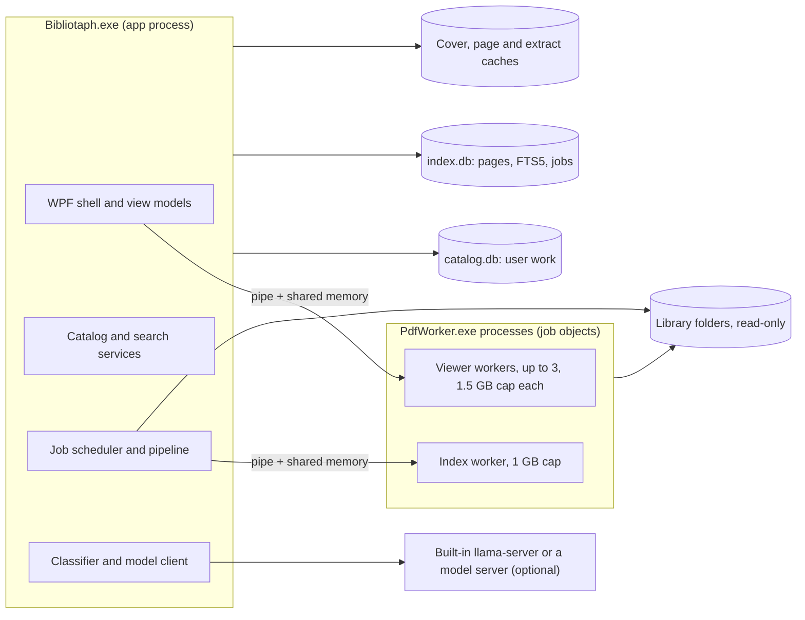

# Bibliotaph architecture

This describes the design of Bibliotaph 1.0. For what the app does, see [features.md](features.md); for how to use it, the [user guide](guide/getting-started.md).

## At a glance

Bibliotaph is one WPF app on .NET 11. PDFium runs in a small pool of isolated worker processes. The user's work lives in one SQLite file and a rebuildable search index in another, searched with FTS5, and an in-process durable job queue reads the library in the background. Bibliotaph catalogs files where they are and never writes to a source file.

## Key decisions

| Decision | Why |
| --- | --- |
| .NET 11, self-contained, per-user | Its support runs to November 2028, the same as .NET 10 LTS; self-contained means nothing to install first. |
| One UI process plus PDFium worker processes, each in a job object | A slow, damaged or hostile PDF being indexed can't stall the page being read or crash the app. |
| Two SQLite files: `catalog.db` (user work) and `index.db` (derived) | "Rebuilding the index never touches the user's work" is a physical fact, not a convention. |
| EF Core for `catalog.db`; Microsoft.Data.Sqlite with Dapper and prepared commands for `index.db` | FTS5's `MATCH`, `bm25()`, `snippet()` and `highlight()` have no LINQ translation, bulk page inserts need prepared commands in batched transactions, and `index.db` has no migrations. |
| SQLite FTS5 for search (bm25, unicode61, diacritics removed) | Fast enough for a large personal collection, with no second storage engine. |
| Windows.Media.Ocr, inside the index worker | Ships with Windows, so no native binaries or language data to package; in a comparison it was as accurate as Tesseract and 7 to 14 times faster. |
| An in-process, durable job queue in `index.db` | Processing runs only while the app is open; a small scheduler is easier to reason about than a framework. |
| WPF with CommunityToolkit.Mvvm and the generic host; a custom theme, no control suite | The design is a bespoke editorial look, not Fluent. |
| AI local first: a built-in llama.cpp engine or an OpenAI-compatible server (Ollama, LM Studio), never a cloud fallback | Book text stays on the machine and costs nothing per book. AI is optional and only suggests. |
| Content identity is SHA-256 of the whole file, with NTFS file IDs to spot moves | Duplicates, moves and revisions fall out without special cases; disk reads, not the hash, dominate the cost. |
| Online libraries through the real site in WebView2 | The user signs in on the service's own page; Bibliotaph keeps no password and reads only what the page shows. |
| Library sync through per-PC files in a folder the user picks | A second PC gets the same work with no sync service and without syncing a live database. |
| Velopack installer and updates from GitHub Releases | Per-user install with no admin, delta updates, and it works with an unpackaged WPF app and native PDFium binaries. |
| GPL-3.0-or-later, with permissive or GPL-compatible dependencies only | The app is free software, and every shipped component can be redistributed under it. |

## Process model and isolation

| Process | Does | Why there |
| --- | --- | --- |
| `Bibliotaph.exe` | Shell, view models, catalog and index access, search, the job scheduler, classification, backup, sync | One process owns the databases, with no IPC for ordinary work. |
| `PdfWorker.exe`, viewer workers | Open, render, tile, find on page, character boxes and links for the books being read | One per reader window showing a PDF, up to three; more windows share the least busy. A reader never shares a worker with indexing. |
| `PdfWorker.exe`, index worker | Probe, page text, covers, OCR of flagged pages, reading a download being checked | OCR needs a rendered bitmap; keeping it beside PDFium keeps large bitmaps out of the app. |
| `aiworker\llama-server.exe` | The built-in AI's model, only while it has work | A native crash or running out of graphics memory takes down only that process. |

`PdfWorkerPool` (Pdf.Host) starts workers on first use and stops a viewer worker when its last reader lets it go. Each worker talks length-prefixed JSON messages over a named pipe and returns pixels through a shared memory section, which the viewer copies into a frozen bitmap. Each runs in its own job object that caps committed memory (1.5 GB for a viewer worker, 1 GB for the index worker), allows one process and no children, and kills the worker if the app dies. A request that times out kills and restarts the worker. `PoisonTracker` remembers which file and page killed a worker; after two kills on the same page the work is refused with that reason, so one bad book can't loop the queue.

The worker opens a PDF through `FPDF_LoadCustomDocument` over a read-only .NET stream, so PDFium never sees the path (names outside the ANSI code page open like any other) and the file is never opened for writing.

## Solution layout

| Project | Holds | References |
| --- | --- | --- |
| `Bibliotaph.Core` | Domain types and enums, the search query parser and field list, effective metadata, page fingerprints, watermark detection, part rules, sync file format and merge; no I/O | Nothing |
| `Bibliotaph.Catalog` | EF Core context and migrations for `catalog.db`, the stores for user work, backup files, JSON and CSV export, applying library sync records | Core |
| `Bibliotaph.Index` | `index.db` schema and upgrades, page and FTS5 writers, search, facet and library queries, the job board | Core |
| `Bibliotaph.Classification` | `IClassifier`, model client, prompts and schemas, excerpt builder, evidence check, rule hints, Ask's prompts and checks | Core |
| `Bibliotaph.Processing` | Scanner, watcher, reconcile, hashing, ZIPs, the pipeline and its stages, metadata projection, built-in AI engine and downloads, Ask, online library readers, backups, library sync | Core, Catalog, Index, Classification, Pdf.Host |
| `Bibliotaph.Pdf.Contracts` | Worker messages and framing | Nothing |
| `Bibliotaph.Pdf.Host` | Worker pool, job objects, shared sections, restarts, poison tracking | Pdf.Contracts |
| `Bibliotaph.PdfWorker` | PDFium and Windows OCR (console exe) | Pdf.Contracts |
| `Bibliotaph.Viewer` | Virtualized page surface, tiles, highlights, selection, links, image view | Core, Pdf.Host |
| `Bibliotaph.App` | Shell, pages, view models, theme, WebView2 windows, Windows-only services, DI composition | Everything above except PdfWorker |

Core and Pdf.Contracts reference nothing, and only App knows about windows. A banned-API analyzer rejects write-capable file APIs everywhere except Processing, Pdf.Host and PdfWorker. Processing opens library files only through `ISourceFileReader`, which has no write path; the worker opens them read-only. Both share read, write and delete, so Bibliotaph never stops the user or a sync client from changing a file.

`tests/` holds unit and integration tests per project with generated fixtures; `tools/` holds the licence notice generator and other build helpers; `build/` holds the verify script and the built-in AI engine pin.

## Storage

Everything lives in `%LOCALAPPDATA%\Bibliotaph\`, never in a synced folder. Both databases run in WAL mode; the UI reads through separate connections, and all writes to `index.db` go through one writer that batches pages into transactions.

| File | Holds | On schema change |
| --- | --- | --- |
| `catalog.db` | Everything the user made or decided, and what can't be derived again | An EF Core migration, after an automatic `VACUUM INTO` copy |
| `index.db` | Everything derived from files or projected from `catalog.db` | An additive change runs its embedded `upgrade-N.sql` in a transaction (schema version 18); anything else, or a failed upgrade, drops the file and rebuilds it, re-queuing documents by content hash |
| `cache\` | Covers by content hash; page thumbnails per book (`cache\pages\`, trimmed past 256 MB, least recently opened first); files extracted from ZIPs (`cache\extract\`, trimmed past 5 GB); site icons | Deleted freely; never backed up |

Beside them are `backups\`, `logs\`, the WebView2 profile (`browser\`), the built-in AI's downloaded engine (`engine\`) and models (`models\`).

### catalog.db

- **Files and documents.** `source_root` (path, volume serial, availability), `file_location` (root, relative path, size, modified time, NTFS file ID, content hash, state: present, missing or online-only; a file inside a ZIP points at its ZIP and records its entry path and CRC) and `document`, one row per distinct content (hash, format, page count, capabilities, protection).
- **Entries.** An `entry` is what the library lists and the user catalogs: a whole document, a part (an adventure inside a file), a pack of images, or a book owned elsewhere with no file. `entry_source` says which documents an entry shows, with a page range for a part, and which is current. Joins (`entry_join`) record the rows they moved, so Undo and "Not the same book" can move them back. `copy_decision`, `version_proposal`, `elsewhere_match`, `pack_decision` and `part_proposal` remember the user's answers to Match, packs and parts, so nothing is asked twice.
- **Metadata.** `assertion` holds every value with its origin (embedded, folder, file name, rule, folder rule, user tag, AI, user), evidence pages and quote, run and state. The effective value is computed from it, never stored over it. `rejection`, `vocabulary_term`, `vocabulary_alias`, `ignored_folder_label`, `folder_rule`, `user_tag`, `correction_request` and `classification_run` sit beside it, so a rebuilt index never loses a model's evidence or the record of what was read.
- **The user's own things.** `favorite`, `reading_state`, `collection` and `collection_item`, `smart_view` (saved searches), `pin`, `note`, `session_pack`, `session_section` and `session_item` (binders), `page_ref`, `ask_turn` (Ask this book conversations), `setting` and `sync_state`.

A `page_ref` is a page range on a document, with the printed label and page fingerprint of its first and last pages, so binder items and page notes can be found again in another copy or version.

### index.db

Pages, OCR word boxes, outlines, per-stage status and jobs are keyed by document. `page` holds each page's text, printed label, size, text quality and fingerprint; `page_fts` is an external-content FTS5 table over its text; `page_vec` holds Ask's page vectors, tagged with the embedding model and text version, and dropped by triggers when a page's text changes.

What the library lists is keyed by entry and projected from `catalog.db` by `MetadataProjector`: `entry_doc` (the document an entry shows, its kind, copies and cover), `entry_member` and `member_fts` (a pack's images), `entry_meta` (effective title, labels, levels, players and review counts), `entry_facet` (closed field values behind the filter panel and field search), `term_alias`, `entry_fts` (the Documents tab's columns, including notes), `entry_ai` (which entries a model has read), and the user's marks: `entry_scope` (favorites, collections, binders), `scope_name`, `entry_note` and `entry_opened`.

Projection runs after hints, user edits, classification, packing and sync, and once at startup in the background, one projection at a time. A heart or an open projects only the marks. Because metadata is projected again at every start, an index rebuild loses nothing the user did.

## Files, identity and the processing pipeline

A document is a content hash; a path is where that content was last seen. Two paths with the same hash are copies of one document, a path that moves keeps its document, and new content at a path is a new document.

### Discovery and reconcile

A full scan runs at startup and on demand, and a `FileSystemWatcher` per root feeds the same reconciler while the app is open, debounced until size and modified time settle. A path whose size, modified time and NTFS file ID are unchanged isn't hashed again. A new path whose file ID, size and time match a location that left its own path is that file moved, and keeps its card. Where the disk keeps no file IDs (FAT, exFAT), a file that left one path and arrived at another in the same scan, with the same name, size and time, is taken as moved when nothing else could pair with either; anything ambiguous is hashed and finds its card by content.

An unreachable root, or one whose volume serial changed, goes offline as a whole; its files are never marked missing because of it. Opening a book whose file can't be reached shows a prompt that names the drive or the last folder, with a rescan to find it.

### ZIPs

A ZIP is read in place through the read-only reader with System.IO.Compression and never unpacked beside itself. The ZIP is a location with a hash and no document; each PDF or image inside is a location of its own, hashed as it is decompressed, and joins documents by hash like any file, so a book both loose and zipped is one document and the loose file is preferred. A ZIP saved again keeps the hashes of members with the same name, size and CRC, and a moved ZIP isn't read again. Stages and the viewer get a member extracted to `cache\extract\` and checked against its hash. A member that can't be read (a nested ZIP, a password, too big, damaged) is listed in Files needing attention.

### Online-only files

Files in OneDrive and other cloud-files folders are always indexed, which downloads each as the queue reaches it. Local files go first, and online-only files wait while downloading the next would leave less than 2 GB free. Once a file that was online-only has been read by every stage that reads files, Bibliotaph returns it to online-only with `CfSetPinState(CF_PIN_STATE_UNPINNED)`, which is what Explorer's "Free up space" does; content, path and timestamps don't change. A file the user pinned to the device, one open in the reader, or one the platform refuses stays. This lets a library larger than the disk be indexed in turns, and Settings can switch it off. `CloudFiles`, behind `ICloudFiles`, is the only caller of the cloud files API. Sync apps that stream through their own drive and cache rather than placeholders are left alone.

### Stages

Each stage has its own status per document (pending, running, complete, partial, blocked, failed, skipped) and a version; bumping a version re-runs that stage, and only that one, everywhere.

1. **Fingerprint.** SHA-256; a known hash attaches the path to the existing document and stops. ZIPs are listed here.
2. **Probe.** Page count, protection, permissions, page labels, outline, embedded metadata, capabilities.
3. **Text.** Per-page text and text quality; pages with no or garbage text are flagged for OCR. The book is searchable from here.
4. **Covers.**
5. **Rule hints.** Folder names, the file name and the PDF's own information become provisional assertions (see Metadata).
6. **OCR.** Flagged pages only, page numbering kept.
7. **Match.** Fingerprints each page from stored text and finds copies and new versions (see Copies and versions), then checks the book against the user's tags (see User tags).
8. **Classify.** Has the AI read the book, when AI is set up and on (see Metadata).

Stages 2 to 6 read the file; Reprocess runs them again while the old text stays searchable. Match and Classify read only stored text, wait for the book's OCR, and backfill existing libraries without opening a PDF.

### Job queue and lanes

A `job` row in `index.db` per document and stage holds priority, attempts, not-before time, lease and stage version, unique by content hash, stage and version, so enqueueing is idempotent. Stale leases return to pending at startup. Opening a book moves its pending jobs to the front.

Jobs run in three lanes, each with its own concurrency and pause: Index (probe, text, covers, hints, match), OCR (slow, so it never holds up the next book's text) and Classify (one book at a time). A failure retries with backoff; disk-full or credential failures block the lane with one visible notice. While a model server isn't answering, Classify jobs wait and the lane retries every minute rather than failing; a book the server fails on while it still answers other requests fails alone.

## Books, copies, versions, packs and parts

**Copies and versions.** Match fingerprints each page as lowercase letters and digits, dropping lines that repeat on half the pages (running heads, per-buyer watermarks). A document with the same page count and every fingerprint equal (at least 3 pages, and at least half, fingerprinted) is the same book, and its card joins the older one as a copy. User values come along; a single-value field the two confirmed differently is set aside for a "Copies disagree" card. Otherwise a file sharing at least 60% of its pages with a book, or failing that its title and publisher, is proposed as a new version. Same book in Select mode joins cards by hand the same way. An entry with several sources has one current source, which opens; when its files are all gone the newest copy with a file opens instead.

**Places across versions.** Binder items, page notes and reading places point at page ranges on a document. In another copy or version, `PagePlaces` finds each by its first and last page fingerprints once that version has them; a place not found opens at the same printed page marked "This page changed: check it", and Needs review lists them per version with Use this page.

**Packs.** A folder or ZIP of 20 or more images and no PDF becomes one card, named after it, unless the user split it; 5 to 19 images, or images beside PDFs, are proposed instead. Each image keeps its own entry, pointing at the pack as its parent. The decision is kept by path and follows the folder or ZIP when it moves. Pack together makes or merges packs by hand, through the same join records, so Undo works the same way.

**Parts.** An adventure inside a compilation can be a card of its own: an entry of kind Part whose sources are page ranges in each copy of the file, one span each, never overlapping. The file is never split. Parts come from the reader's bookmarks or a page range, or from proposals: `PartRules` reads bookmarks and adventure blurbs ("for four characters of 3rd level"), and, when AI is on and the rules proposed nothing, the model picks among the same bookmark candidates with quotes that are checked against their pages. A proposal never makes cards until accepted. A part inherits the file's system, edition, publisher, series, year and setting as values of its own source, never over what the user set on it, and is classified on its own pages. `PartsService.FollowAsync` finds each part again in every copy and version by its first and last page fingerprints. In Inside documents, a page is listed under the part it falls in, else under its file.

**Owned elsewhere.** A book owned in print or on a virtual tabletop is an entry with no sources, cataloged by the user's own values, with an Also own field naming where. A file whose title matches such a book, with no publisher that says otherwise, gets an "Is this its file?" card; accepting joins them.

**Check a download.** Hashes a folder or ZIP against the library without adding anything: a known hash is Already owned; other PDFs are read in the index worker and their page fingerprints and hint title and publisher compared as Match would. Nothing is written to either database or the queue.

## Search

- **Parser.** A hand-written parser in Core turns `chase "through a city" type:adventure level:3` into a query tree. Errors carry a position, so the box can underline the bad token and keep the query. One field list in Core serves the parser, its errors and the search field guide under the box. Values are always bound as parameters; the FTS5 `MATCH` string is generated from the parsed query with every term quoted, and column names come from a fixed list.
- **Documents tab.** `entry_fts` over title, subtitle, publisher, series, authors, tags, notes and effective metadata, with bm25 column weights; confirmed and provisional values sit in separate columns, so confirmed ones rank higher. Words also match the file names of images in packs.
- **Fields.** Text fields (`title:`, `publisher:`, `author:`, `series:`, `tag:`) match `entry_fts` columns. Term fields (`system:`, `edition:`, `type:`, `setting:`, `style:`, `theme:`, `environment:`, `duration:`, `own:`, `store:`) match a vocabulary term by key, label or alias through `entry_facet` and `term_alias`, with `*` prefixes. `level:` and `players:` match overlapping ranges. `favorite:`, `collection:`, `where:` (here or elsewhere), `format:` and `folder:` filter by marks and places. Any field takes `unknown` and `-`.
- **Inside documents tab.** `page_fts` over page text, with `snippet()` quoting the page; hits are grouped and limited per book in SQL. Highlights aren't stored: opening a hit runs find on that page in the viewer worker.
- **Facets.** Counts are `GROUP BY` over `entry_facet` for the current results, leaving out the facet's own dimension. Levels are ranges per system; unknown is a real value.
- **Coverage.** While books are still being read, results say "Searching text in N of M documents".
- **Saved searches.** A saved search stores the search text, scope, filters, order, layout and tab as versioned JSON, never a list of books, so opening it runs the search again.
- **Ask.** A mode of the search box that has the AI turn a plain-English request into ordinary search terms. `PlainSearchPrompt` sends only the request (cut to 500 characters, in guarded tags) and the vocabulary's names; the answer can only fill a schema of field filters and words. `PlainSearchCheck` drops any field the box doesn't have, any vocabulary value that isn't a term, and any word that isn't the user's own; every kept piece must parse with the box's own parser, and every change is explained. The pieces show as editable chips, and nothing runs until the user presses Search, which puts them in the box as query text.

## Viewer

`Bibliotaph.Viewer` is built so a page never waits for a full-quality render.

1. **Preview first.** A render at a quarter of the target scale shows first, replaced by the full render. Scanned pages, whose whole image decodes at any scale, preview from cached page thumbnails.
2. **Prefetch and cancel.** Two pages ahead in the scroll direction; requests for pages scrolled away are dropped.
3. **Tiles.** Above 200%, or for very large pages, 512-pixel tiles with a memory budget.
4. **Labels.** "Printed p. 42 · PDF page 46 of 180"; where a book was left is kept apart from search jumps.
5. **Selection and copy.** The worker returns character boxes with each page; OCR'd pages select against stored word boxes. A PDF that forbids copying disables Copy with the reason.
6. **Thumbnail strip.** A virtualized strip of every page, drawing only those in view and four either side, from memory, then the `cache\pages\` thumbnails, then an idle render lane that runs only while no page render waits. Pages with notes have a badge; a binder item's pages have a bar.
7. **Links.** Link annotations are read when the pointer reaches a page; page links jump with Back, web links open in the browser after asking (http, https, mailto). A contents or index page with no links of its own gets links made from the printed page numbers it lists (`PageReferences`), mapped through page labels or, failing that, through the page numbers printed in the book's own text; with neither, no links are made, since a wrong jump is worse than none.
8. **Windows.** Any number of pop-out reader windows, each with its own viewer worker up to the cap. A binder's reader opens the next item's book ahead of time on the same worker and draws its first page, so Next shows it at once.

JPG, PNG and WebP open in an image view with zoom and pan, decoded at a capped size; WebP uses Windows' own decoder.

## Metadata and classification

### Effective values

`EffectiveMetadata` (Core) computes each field from its assertions, never storing the result. Origins rank user 100, folder rule and user tag 60, AI 50, rule 30, embedded 20, folder 15, file name 10. For a single-value field the latest confirmed value wins and is never replaced by a suggestion; otherwise the best-ranked suggestion applies and the rest are alternatives. For a multi-value field the value is every confirmed value plus the top origin's suggestions that arrived after the user's last decision there. A closed field needs review when an alternative arrives after the last decision. Rejections (entry, field, normalised value) suppress a value from every origin, including later models. Every decision, bulk edit and correction is undone from a snapshot of the field's assertions and rejections.

### Rule hints and folder rules

Hints run on every file: a folder name counts only when it matches a vocabulary term or alias (each such folder label can be switched off), the deepest folder wins a single-value field, an edition implies its system, junk embedded titles are skipped, and levels and party sizes are read from the file name, title and subject. Get it from comes from a store named in a folder name, file name, the PDF's producer or a watermark line; watermark lines (`Watermarks`, Core) are found in memory, matched against the store vocabulary and then dropped, never stored, logged or sent to a model. Re-running replaces earlier hints by diffing, so an unchanged suggestion keeps its age, and never touches a value the user decided.

When the user decides the same value for a field on three or more books directly in one folder, a folder rule is proposed; once accepted it suggests that value, with origin folder rule, for every file in the folder and below. After a correction, the details offer to repeat it on look-alikes: books in the same folder whose field shows exactly what the corrected one showed before.

### Needs review and vocabulary

`MetadataReview` (Core) decides the cards: a closed field whose sources disagree, a book with no usable title, and optionally every unconfirmed value. Copies disagree, new versions, packs, parts, folder rules, new terms, changed pages and correction requests have cards of their own.

Vocabularies (systems, editions, types, settings, styles, themes, environments, durations, stores, places owned) live in `catalog.db` as terms with aliases and parents, seeded from versioned starter sets. A name means one term per vocabulary. A term the model proposes that the vocabulary doesn't know becomes a pending term whose values are held back until the user adds, maps or rejects it. After a vocabulary edit, every book is projected and hinted again in the background.

### User tags

The user's own tags live in `catalog.db` (`user_tag`: name, comparison name, the words as JSON). `UserTagService` turns a tag's words into an FTS5 expression of quoted words (a word of three letters or more also as a prefix, as search reads it) and asks `page_fts` which cards' pages have any of them, through `entry_doc`, so an adventure counts only its own page range. A card whose words are on at least 3 pages and at least 5% of its pages with text (`UserTagRule`) gets a provisional `tags` assertion of origin user tag, with the words as its quote and up to 12 of the pages as evidence. Saving a tag replaces its guesses across the library as rule hints are replaced: a guess made again keeps its row and age, and decided rows and rejections are never touched. Deleting a tag removes its undecided guesses. Match, once a book's text and OCR are in, checks it against every tag, and Forget its text removes its undecided guesses. Tag definitions stay on each PC; the tags on books travel with the metadata decisions.

### Classification

- **Input.** An excerpt of about 24,000 characters: the first pages with text, the back cover, contents pages, the introduction, then pages sampled evenly, each after a `[Page N]` marker, with watermark lines removed. The system message holds the rules, field definitions and the vocabulary's names, and nothing from the book. The user message holds the file name, up to three worked examples (the user's own confirmed values on similar books, never book text) and the excerpt inside `<book-excerpt>` tags. A library folder can be kept from AI.
- **Output.** A JSON schema with one array per field, each item `{value, page, quote}` and nothing else; an empty array is unknown. Tags are never filled by AI. The field list in `ClassifierPrompt.Fields` drives the schema, parsing and evidence check.
- **Evidence check.** A claim stands only if its quote appears on the page it cites (compared as letters and digits after normalisation, at least 8 of them) and, for printed values such as title, publisher, year, levels or system, the quote names the value. Values must parse and closed fields must resolve through the vocabulary. Kept claims become provisional AI suggestions; the user's values always win.
- **Untrusted text.** Book text goes only in the delimited data block, with anything that looks like its closing tag or a page marker altered. The client exposes no tools, keys outside the schema are ignored, and nothing in an answer can change a setting, a tag or a user decision. Logs get counts and reasons, never book text or quotes.
- **Runs.** Each run records provider, model, prompt and schema version, content hash, pages read and outcome in `classification_run`. Changing model or prompt never reclassifies by itself; Settings offers to.
- **AI reading.** A page shows the book being read, the answer's fields as they stream in (parsed from unfinished JSON), and what the evidence check kept and dropped, from an in-memory feed of the last 20 books.

### Model access

One client over `HttpClient` and System.Text.Json, with no SDK. Ollama is asked through `/api/chat` with the schema as `format`; other servers through `/v1/chat/completions` with a strict `json_schema` response format, falling back to `json_object`. Answers stream. An endpoint off this computer's network needs an explicit "Send excerpts to this server", and an API key goes to Windows Credential Manager.

**Built-in AI.** Bibliotaph ships llama.cpp's `llama-server` (the Vulkan build, which falls back to the processor) in `aiworker\`, pinned by release and SHA-256 in `build/engine.json`; a build without it downloads and verifies the same pin into the data folder. `BuiltInEngine` starts it on first use on 127.0.0.1 and a free port with a one-time API key, one request at a time, waits for `/health`, and talks to it through the same OpenAI-compatible client. The context starts at 16K tokens and grows when a book needs it. It stops after 5 idle minutes, when the Classify lane pauses, when AI is switched off or moved to a server, and with the app; a job object ensures it never outlives the app. Models (Qwen3 8B and 4B, Apache-2.0) are pinned to a Hugging Face revision, size and SHA-256, downloaded only when the user asks, resumable, and renamed into place only once the hash matches. `GraphicsMemory` reads adapter memory from the driver's registry values to suggest the largest model that fits. Runs on the built-in engine count as a different model from the same one on a server.

### Ask this book

A panel in the reader answers questions about the open PDF from its pages.

- **Retrieval.** The question's words (stop words removed, as quoted FTS5 prefixes) against `page_fts`, and, with an embedding model set, the question's vector against `page_vec` by cosine; the two rankings are fused by reciprocal rank, with a small boost for pages under a matching bookmark, and pages whose text reads like an index, contents or glossary (dot leaders, short lines ending in page numbers, or mostly page numbers) keep half their score. A weak-signal guard says the book doesn't cover the question rather than choosing evidence: words count when the best page by words has half the question's weight, each word weighing one over the number of the book's pages with it, and meaning counts when the best page is close and stands out. Up to 8 pages (24,000 characters) become the evidence. Page vectors are filled in the background when the book is opened in the reader, or on first ask. Chat requests ask the model not to think (Ollama's `think`, or `chat_template_kwargs.enable_thinking` for OpenAI-compatible servers), dropping the switch for a server that refuses it.
- **Answer.** The chat model gets rules in the system message and the pages in the same guarded excerpt block as classification. `AskAnswerCheck` checks the answer as it streams: citations to pages that were sent become links, others are removed and their sentences marked, and each quotation is looked for on its cited pages and shown unquoted when it isn't there.
- **Conversations.** Turns are kept in `catalog.db` (`ask_turn`, the last 50 per book), so a rebuilt index keeps them. A follow-up is first rewritten to stand alone from the last three turns, without any book text. "Forget its text" forgets the conversation too.

### Ask your library

**Answer from my books** in the search box's Ask mode answers a question from pages across the library (`LibraryAskService`, Processing; `LibraryAskQueries`, Index).

- **Scope.** Each `AskFilter` becomes a `PageScope` (whole documents, or page ranges of them), and the question reads the pages every filter allows. Today's filter, `BookFilter`, is the Library's filter panel and the search box's fields (its plain words dropped), as the Library last ran them (`LibraryAskScope`); `LibraryQueries.GetPageSpansAsync` turns it into each PDF's pages, or an adventure's own range. A filter on chapter tags would add page ranges the same way. Only documents a card shows count, and documents in folders kept from AI are left out of the scope and checked again before any page is used.
- **Retrieval.** Ask this book's ranking at library scale: words through `page_fts` within the scope (100 deep), meaning by streaming the scope's vectors past a top-k `MeaningRanking` (the library's vectors aren't held at once), reciprocal-rank fusion with the bookmark boost and the list penalty, then `CapPerBook` keeps at most three pages a book before choosing up to 10 pages (3,000 characters each, 24,000 in all). The weak-signal guard weighs words by how rare they are across the scope and compares the best cosine with the scope's median; when it fires, no model is asked and the closest pages are named.
- **Answer.** `AskPrompt.LibrarySystemMessage`, with each page's book title in the guarded block and a marker of book number and page ("2:112"), so a bare page number the model invents never names a page sent. `AskAnswerCheck` checks it as for one book, against each page's place in the evidence, and citations become the book's title and page, with the document they open (`AnswerPart.DocumentId`). There is no conversation.
- **Reading the library for meaning.** `LibraryVectors`, a hosted service, makes page vectors book by book with Ask this book's fill code and storage (`page_vec`), in document order, a minute after start. It gives way between batches while `AiUse` says the user is asking anything of the AI (and for 30 seconds after) or a book opened in the reader wants its vectors, backs off five minutes when the model fails, and needs no queue of its own: what it made is in `page_vec`, so after a restart it carries on with the first book still missing some. `ai.embedding.library` ("False") switches it off; Settings > AI shows its progress in pages.

## Online libraries

Bibliotaph reads the libraries of online services (D&D Beyond, Demiplane) and stores (Humble Bundle, DriveThruRPG, which also serves DMs Guild) so the books owned there become cards owned elsewhere.

- **Browser.** `OnlineBrowserWindow` hosts WebView2 with one profile for all of Bibliotaph's windows in the data folder's `browser\`, so sign-ins last between visits and stay apart from the everyday browser. It opens the service's library page and never navigates, clicks or scrolls by itself. After each page settles it takes the page's HTML and offers Read this page when a reader recognises it. Bibliotaph stores no password; Sign out of all services clears the profile through WebView2. Pop-up windows a page opens are hosted by Bibliotaph too, so sign-ins and downloads work.
- **Readers.** One `IOnlineLibraryReader` per service turns a page into books (title, link, publisher, type, system, year, cover address) and fetches nothing. D&D Beyond's reads the Next.js data its page carries; the others read markup cut at each book's card. A reader also says where a book's link goes: Also own for a service whose books are read online, Get it from for a store whose books are files to download.
- **Imports.** `OnlineImports` previews what a page would change: a link already on a card updates only its empty fields, a card with the same title gets the link, anything else is new, and a whole-library page also lists linked books it no longer shows. Ticked rows are written in one transaction as the user's own confirmed values, with Undo. Covers are only images the page already loaded (or a saved page's files), never fetched.
- **Online reader.** A book owned only online opens in a reader built around the service's own page, with the same profile, so it is signed in. It follows links on the book's site and its sign-in sites; anything else goes to the everyday browser. It copies no text from the page, so it has no search, notes on pages or Ask. An optional reading-mode stylesheet per service hides the site's chrome. A page can be added to a binder by its address.
- **Downloads.** A download the user starts on a store's page is saved into a downloads folder inside a library folder, under a free name, by the browser; the folder is then scanned and the file read like any other, so "Is this its file?" offers it to its book.
- **Site icons.** Fetched once per site into the cache for the cover badge, unless switched off.

There is no automation: Bibliotaph acts on a service's site only through the user's own clicks.

## Collections, saved searches and binders

Favorites, collections (nested to any depth, holding entries), saved searches and pins are rows in `catalog.db`, projected into `entry_scope` so search and the Library's scope can use them. Joins move a book's heart, collections, pins, notes and binder items to the card it joins, and "Not the same book" moves them back.

A binder (`session_pack` in code) is an ordered list of items in named sections, each a whole book, a page range (`page_ref`) or a page of an online book, with a label and note. Opening a binder shows its reader: the items down the left, the book in the middle, the binder's notes on the right, Next and Previous stepping between items. An item whose file can't be reached stays, dimmed, saying why. A binder can be kept at hand during games, optionally for a game system, and then shows in every other binder's reader to open a page in a window of its own.

Notes are a book's own note and notes on page ranges; they are found again in other copies through `page_ref` like binder items, and search reads them through `entry_fts.notes`.

## UI shell

- **MVVM.** CommunityToolkit.Mvvm source-generated view models; services from the generic host's DI container. Long-running work is hosted services in Processing.
- **Navigation.** Routes for Home, Library, Collections, Binders, Needs review, Settings, the reader, the online reader, Check a download and AI reading. A back stack restores search, filters, selection and scroll position when leaving the reader. The sidebar's Pinned group lists pins in order, reorderable by drag or Alt+Up and Alt+Down. Reader windows and a binder can pop out into windows of their own.
- **Theme.** The design's colour tokens are brushes in Light and Dark dictionaries, following the Windows app mode unless overridden, plus a Contrast dictionary built live from the system colours under a Windows contrast theme. DM Sans for the interface and Libre Caslon Display for display headings, both embedded; Lucide icons as geometry resources. Animations are off when Windows' animation effects are.
- **Library.** The cover grid uses `VirtualizingWrapPanel`, with covers decoded off the UI thread at display size and frozen. Filters show as chips; Select mode drives bulk edits, Same book, Pack together, Remove adventures, collections and export.
- **Accessibility.** Per-monitor DPI, automation names on every control, a keyboard path for every action, and Ctrl+/ to list shortcuts (Ctrl+K search, Ctrl+F find in book).

## Safety and secrets

- **Source files.** Bibliotaph never writes to a source file: one read-only reader, a banned-API analyzer, and worker processes that open files read-only. The one exception is returning a file indexing downloaded to online-only, which changes no byte, name or timestamp and is confined to `CloudFiles`. Browser downloads are written by WebView2 into the chosen downloads folder, never by Bibliotaph's code.
- **Passwords.** A PDF password can be remembered, keyed by content hash so it survives moves and covers copies, which lets the index worker read that book unattended; otherwise it is kept in memory for the session. A file that forbids copying is still indexed, with Copy off in the reader. A PDF whose security handler PDFium can't open is marked Protected, keeps editable details and offers Open in another app.
- **Secrets.** Saved PDF passwords and API keys go to Windows Credential Manager (`Bibliotaph:pdf:` and `Bibliotaph:ai:` targets), local to the machine; never in the databases, logs, exports, backups or prompts.
- **Forget its text.** A flag on the document stops indexing it; its pages, FTS rows, vectors, outline, jobs, cover, thumbnails, AI runs, undecided suggestions and Ask conversation are removed. "Read it again" clears the flag.
- **Logs.** Rolling Serilog files in the data folder's `logs\`; page text, prompts, requests and passwords are never logged, only counts and reasons.

## Backup, restore and library sync

**Backup.** A zip of a `VACUUM INTO` copy of `catalog.db`, optionally `index.db`, and a `manifest.json` (app version, catalog schema, library folders, counts). One is made on demand and one automatically each week, keeping the last four automatic ones. Restoring stages the zip (an older catalog is migrated, a newer one refused), lets the user point moved library folders to their new place, and swaps the catalog in at the next start before any database opens, keeping the old one beside it. Machine-specific data (volume serials, file IDs) is cleared, and the index is rebuilt without hashing files again when the backup carried it. Export writes a CSV of the books or JSON of every catalog table.

**Library sync.** A folder the user picks (in OneDrive, say) holds one JSON file per PC, `Bibliotaph sync\<PC name>.json`; each PC writes only its own and reads the others'. Records travel by stable keys: books by content hash (with other copies' hashes as aliases), everything the user made by a `sync_id` GUID. What travels is the user's work: metadata decisions per field, hearts, notes, collections, saved searches, binders, pins, vocabulary terms, "Not the same book" answers and books owned elsewhere. Library folders, reading places, settings, AI runs and caches stay on each PC, and library files are never touched. `SyncMerge` (Core) merges per field, the newer change winning and deletions winning over earlier changes through kept tombstones; it is idempotent. `CatalogWrites`, an EF Core interceptor, notices writes to user-work tables and has this PC's file written shortly after. Work on a book this PC doesn't have waits until a file with that hash appears.

## Packaging, releases and updates

- **Installer.** Velopack, per-user with no admin, self-contained win-x64: the app and the PDF worker in `pdfworker\` each carry .NET, and the AI engine sits in `aiworker\`. The pack id `BibliotaphApp` installs into `%LOCALAPPDATA%\BibliotaphApp`, which uninstalling deletes, deliberately apart from the user's data in `%LOCALAPPDATA%\Bibliotaph`. `Program.Main` runs Velopack's hooks before anything else. The installer is unsigned, so Windows shows "unknown publisher".
- **Releases.** A `vMAJOR.MINOR.PATCH` tag runs the release workflow, the only one with write access: verify, publish the app and worker at the tag's version, generate licence notices, download the latest published release so `vpk pack` makes a delta, and create a draft GitHub Release with Setup.exe, the packages and their feed. A maintainer publishes the draft.
- **Updates.** `UpdateService` checks the repository's published releases (never drafts or pre-releases) with Velopack's `GithubSource` at start and once a day, and downloads in the background. A ready update shows in the sidebar; Bibliotaph restarts to apply it only when the user clicks, closing the databases first, and an update not applied is applied at the next start. It is silent offline, on errors, and in builds that weren't installed. A fork's release build updates from that fork.

## Licences

Bibliotaph is GPL-3.0-or-later. Every dependency is permissive or GPL-3.0-compatible (MIT, Apache-2.0, BSD, ISC, Zlib, LGPL, SIL OFL for fonts, SQLite's public-domain blessing); AGPL and revenue-gated libraries are excluded. The Windows SDK projection the worker uses for OCR ships under a GPL section 7 additional permission (`LICENSE-EXCEPTION.md`). The app's `licenses\` folder carries `LICENSE`, `THIRD-PARTY-NOTICES.md`, the font and icon licences, llama.cpp's and its OpenMP runtime's licences, PDFium's notices, and a generated licence file for every package in the app's and worker's dependency lists, including the .NET runtime; generation fails on an unknown or incompatible licence. The About popup shows the version and commit, the copyright, the GPL's no-warranty line and links to those files, so forks keep the notices.
